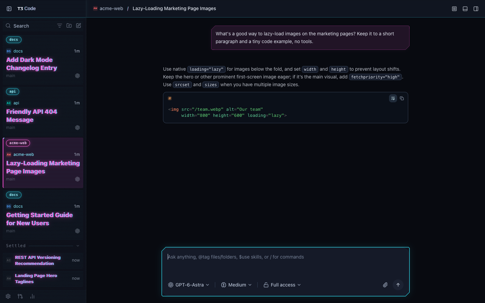

# T3 Code custom CSS theme showcase

Example themes for a proposed T3 Code feature: themes that carry their own CSS, stable
`data-t3-part` hooks to target, and theme tools agents can call through the T3 Code MCP server.

- Proposal: [Ideas discussion on pingdotgg/t3code](https://github.com/pingdotgg/t3code/discussions/categories/ideas)
- Code: the [`custom-css-theming`](https://github.com/TimPietrusky/t3code/tree/custom-css-theming) branch

> Custom CSS isn't in a released T3 Code yet. In a current release, importing one of these themes
> applies its colors and ignores the CSS. Run the `custom-css-theming` branch to see them as shown.

## An agent restyles the app from one prompt

"Make my T3 Code mint green with big, wrapping thread titles and each thread's project as a little
pill." The agent only uses the T3 Code theme tools: it reads the theme guide, writes a theme and sets
it, and the open app switches live.

| Before | After |
| --- | --- |
|  |  |

[Recording (mp4)](images/agent-restyles-live-app.mp4)

## Themes

### Pink Love

Big wrapping thread titles, no project icons, and each thread's project as a pill on its top edge.
Light and dark.

[`themes/pink-love.json`](themes/pink-love.json) · [dark](images/pink-love-dark-full.png) ·
[sidebar](images/pink-love-light-sidebar.png)

### Bevel 98

Grey 3D bevels, gradient title bars, a pressed-in active row and a composer drawn as a dialog window.

[`themes/bevel-98.json`](themes/bevel-98.json) · [sidebar](images/bevel-98-sidebar.png)

### Pocket Green

A four-shade handheld screen: pixel-stepped borders, a dot-matrix background and chunky monospace
capitals.

[`themes/pocket-green.json`](themes/pocket-green.json) · [sidebar](images/pocket-green-sidebar.png)

### Neon Sunset

A striped sun over a perspective grid behind the conversation (inline SVG), chrome titles and sunset
pills.

[`themes/neon-sunset.json`](themes/neon-sunset.json) · [sidebar](images/neon-sunset-sidebar.png)

### Neon Circuit

Magenta and cyan on near-black with glowing, chamfered borders and scanlines. Written entirely by an
agent from one prompt through the theme tools.

[`themes/neon-circuit.json`](themes/neon-circuit.json) · [sidebar](images/neon-circuit-sidebar.png)

## The theme editor's CSS tab

## Use a theme

- **Import:** Settings → Appearance → **Add theme**, then choose the JSON file (or paste it).
- **Publish on a machine:** copy the file into `~/.t3/userdata/themes/` on the machine running
  T3 Code. The filename is the theme id; select it in Settings → Appearance or run
  `t3 theme set <id>`.
- **Ask your agent:** with the theme tools, describe the look you want in a thread with Full access.

The CSS targets `data-t3-part` hooks such as `thread-title` and `thread-project`; see
[`docs/user/custom-css.md`](https://github.com/TimPietrusky/t3code/blob/custom-css-theming/docs/user/custom-css.md)
on the branch for the full list. Screenshots use invented demo projects.
