# T3 Code custom CSS theme showcase

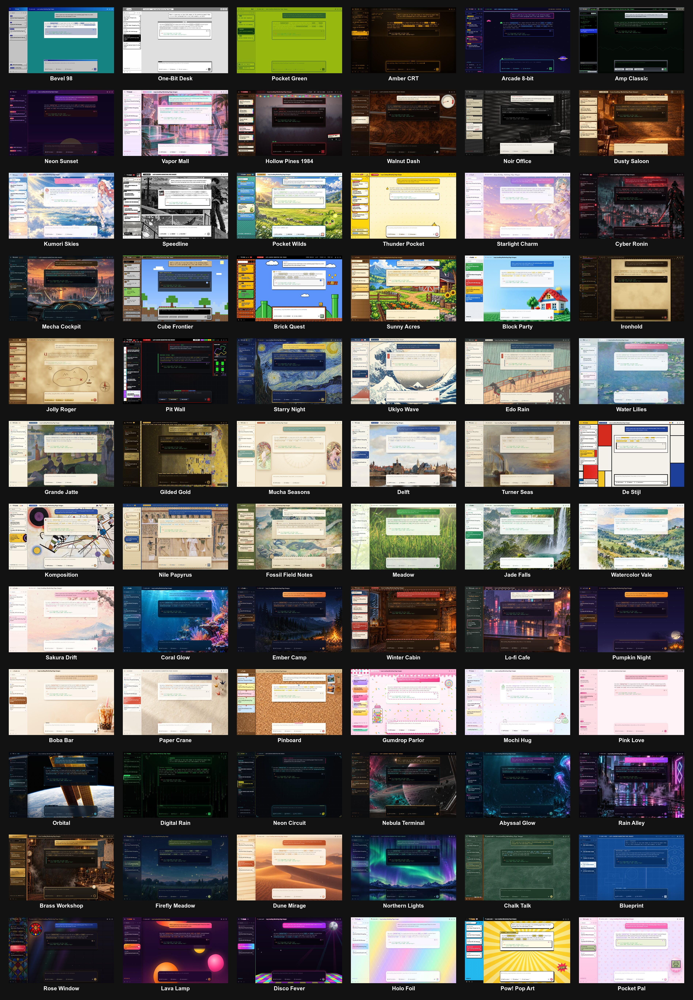

Example themes for a proposed T3 Code feature: themes that carry their own CSS, stable
`data-t3-part` hooks to target, and theme tools agents can call through the T3 Code MCP server.

- Proposal: [Ideas discussion on pingdotgg/t3code](https://github.com/pingdotgg/t3code/discussions/19088)
- Code: the [`custom-css-theming`](https://github.com/TimPietrusky/t3code/tree/custom-css-theming) branch

> Custom CSS isn't in a released T3 Code yet. In a current release, importing one of these themes
> applies its colors and ignores the CSS. Run the `custom-css-theming` branch to see them as shown.

## The video

[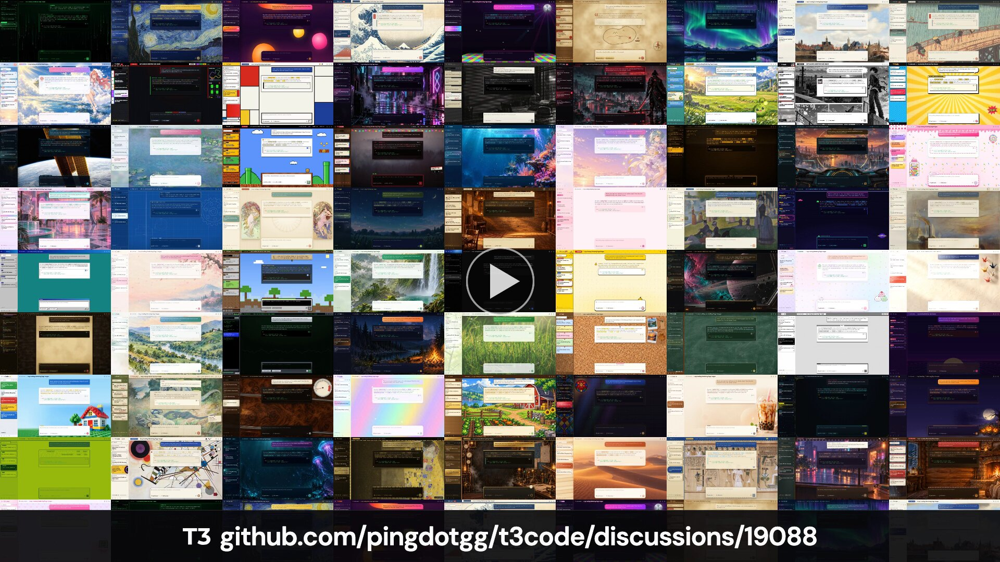](images/theme-showcase-16x9.mp4)

[16:9 (mp4)](images/theme-showcase-16x9.mp4) · [1:1 (mp4)](images/theme-showcase-1x1.mp4). The run-through part:

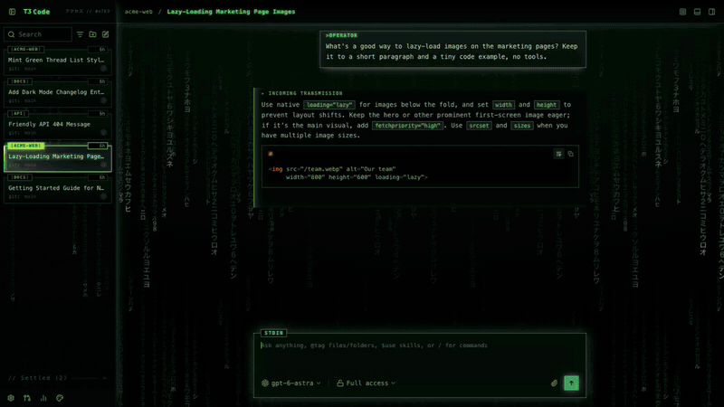

## Use a theme

- **Import:** Settings → Appearance → **Add theme**, then choose the JSON file (or paste it).
- **Drop it in:** copy the file into `~/.t3/userdata/themes/` on the machine running T3 Code. The
  filename is the theme id; select it in Settings → Appearance or run `t3 theme set <id>`.
- **Ask your agent:** with the theme tools, hand it a file or describe the look you want in a thread
  with Full access.

\* Themes marked with * embed their own images (photos or original art), which needs the images-in-themes
support on the `custom-css-theming` branch. Credits: [`themes/ASSET-CREDITS.md`](themes/ASSET-CREDITS.md).

## Switching themes

Type `/theme` in the composer to list every theme, and keep typing to filter:

| `/theme` | `/theme sk` |
| --- | --- |
| 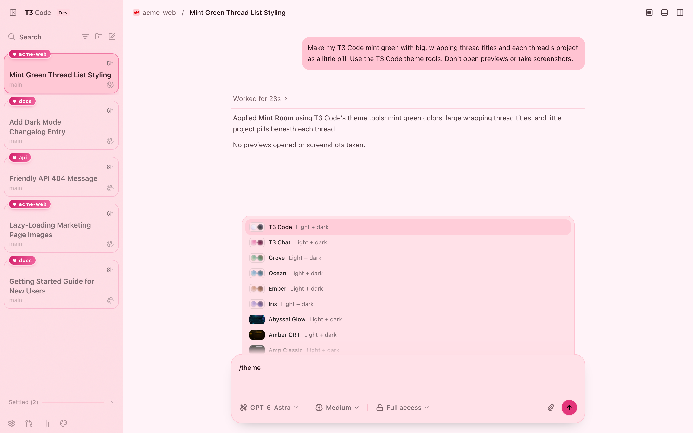 | 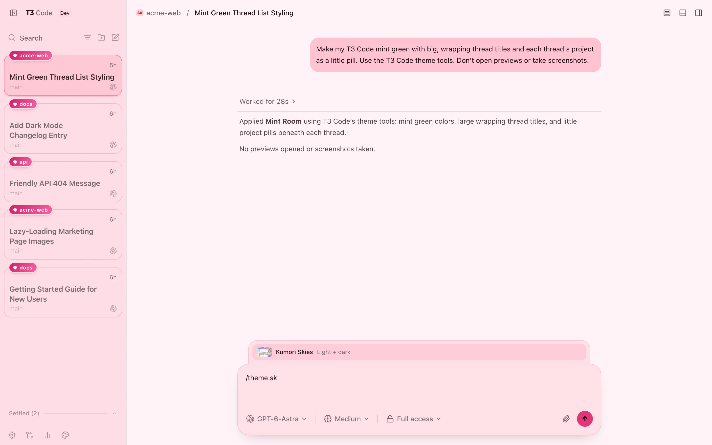 |

The quick switcher previews each theme on the live app as you move through it with the arrow keys;
Enter applies, Esc cancels.

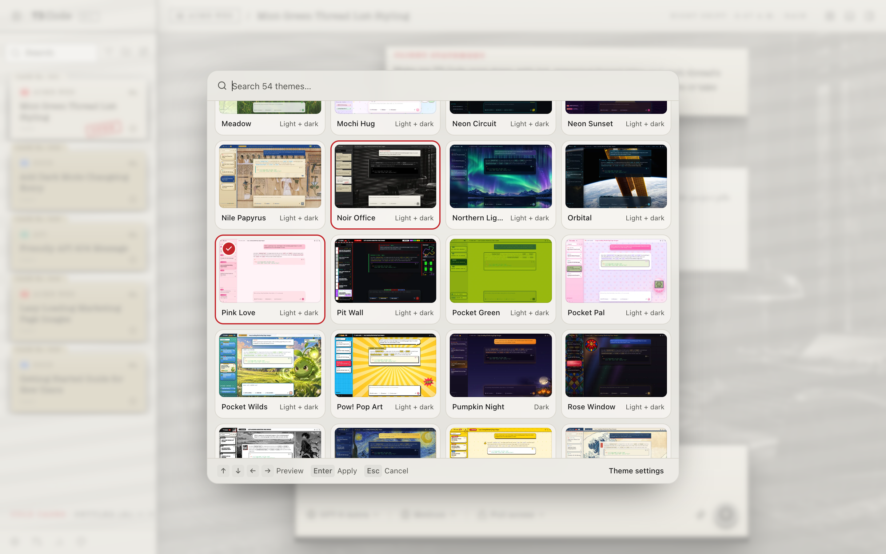

Settings → Appearance shows every theme as a card next to the built-in palettes, with the modes it
supports.

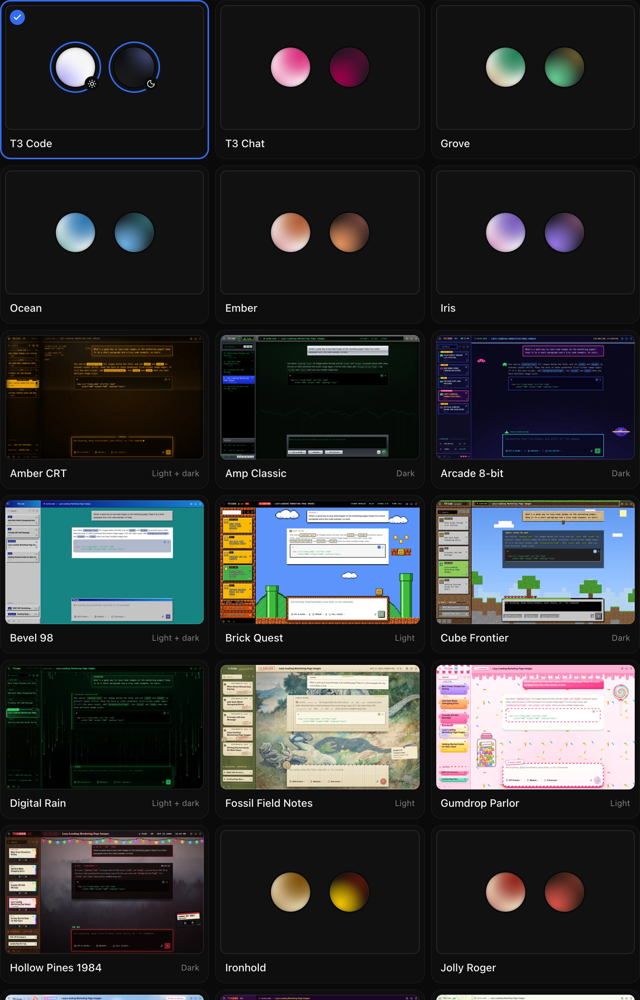

Themes can react to the agent. In Pit Wall the car laps the track map while the agent works, and
the pit board calls BOX BOX:

| Working | Box box |
| --- | --- |
| 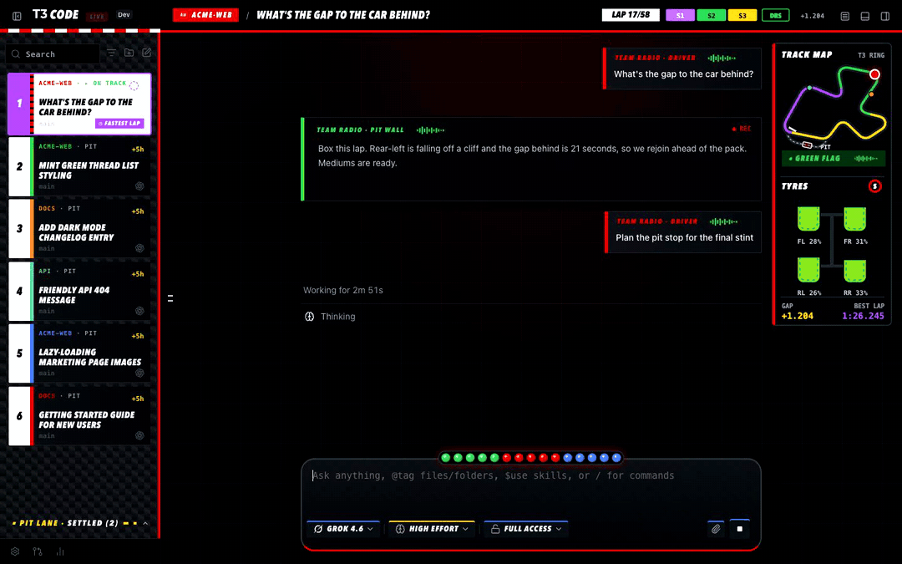 | 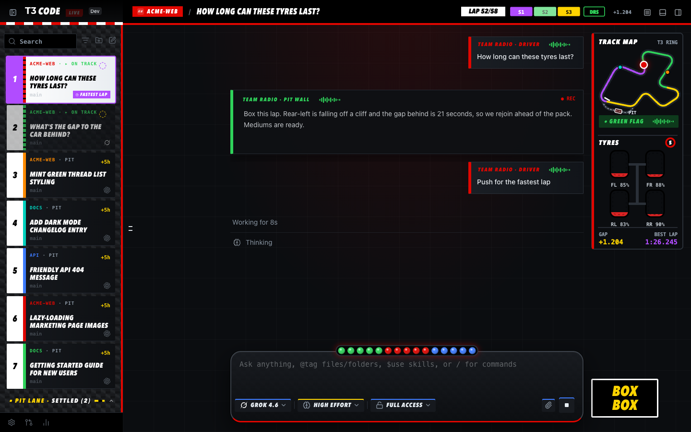 |

## Themes

72 themes, grouped loosely. Each has a full-window screenshot, a sidebar close-up and, where it has one, its other mode.

### Retro

#### Bevel 98

Grey 3D bevels, gradient title bars and a composer drawn as a dialog window.

[`themes/bevel-98.json`](themes/bevel-98.json) · [sidebar](images/bevel-98-sidebar.png) · [dark](images/bevel-98-dark-full.png)

#### One-Bit Desk

An early-GUI black-and-white desktop drawn in CSS: a dithered desk, pinstriped title bars and hard drop shadows. Dark mode inverts it.

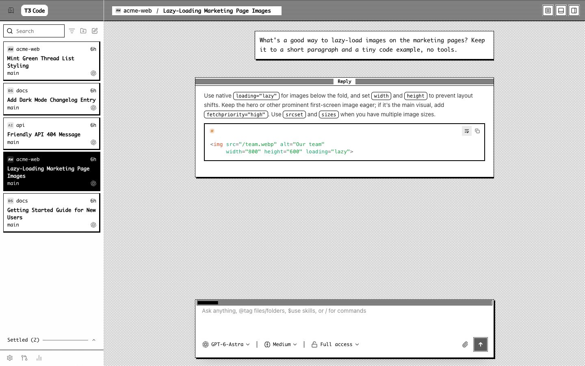

[`themes/one-bit-desk.json`](themes/one-bit-desk.json) · [sidebar](images/one-bit-desk-sidebar.png) · [dark](images/one-bit-desk-dark-full.png)

#### Pocket Green

A four-shade handheld screen with pixel-stepped borders and a dot-matrix background.

[`themes/pocket-green.json`](themes/pocket-green.json) · [sidebar](images/pocket-green-sidebar.png) · [dark](images/pocket-green-dark-full.png)

#### Amber CRT

A curved amber phosphor tube with scanlines, glow and a blinking cursor.

[`themes/amber-crt.json`](themes/amber-crt.json) · [sidebar](images/amber-crt-sidebar.png) · [light](images/amber-crt-light-full.png)

#### Arcade 8-bit

A deep-space cabinet with notched pixel frames, invader sprites, coins and a score line.

[`themes/arcade-8bit.json`](themes/arcade-8bit.json) · [sidebar](images/arcade-8bit-sidebar.png) · [light](images/arcade-8bit-light-full.png)

#### Amp Classic

A brushed-metal MP3 player skin: playlist sidebar, LCD title and a live spectrum. [Live](images/amp-classic-live.gif).

[`themes/amp-classic.json`](themes/amp-classic.json) · [sidebar](images/amp-classic-sidebar.png) · [light](images/amp-classic-light-full.png)

#### Neon Sunset

A striped sun over a perspective grid, chrome titles and sunset pills.

[`themes/neon-sunset.json`](themes/neon-sunset.json) · [sidebar](images/neon-sunset-sidebar.png) · [light](images/neon-sunset-light-full.png)

#### Vapor Mall

A pastel 1980s mall atrium at sunset, marble bust and all: retro OS windows, chrome type and a flickering neon sign.*

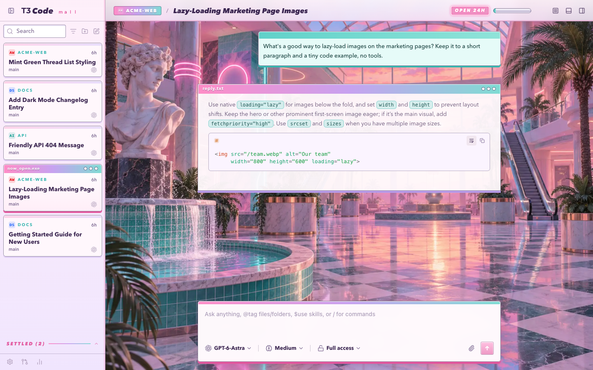

[`themes/vapor-mall.json`](themes/vapor-mall.json) · [sidebar](images/vapor-mall-sidebar.png)

#### Hollow Pines 1984

A small town after dark: cassette tapes for threads, a foggy pine forest, string lights and a VHS on-screen display.*

[`themes/hollow-pines.json`](themes/hollow-pines.json) · [sidebar](images/hollow-pines-sidebar.png) · [light](images/hollow-pines-light-full.png)

#### Walnut Dash

The burl-walnut dash of a 1950s car. A chrome gauge reads how full the context is and trembles while the agent works.*

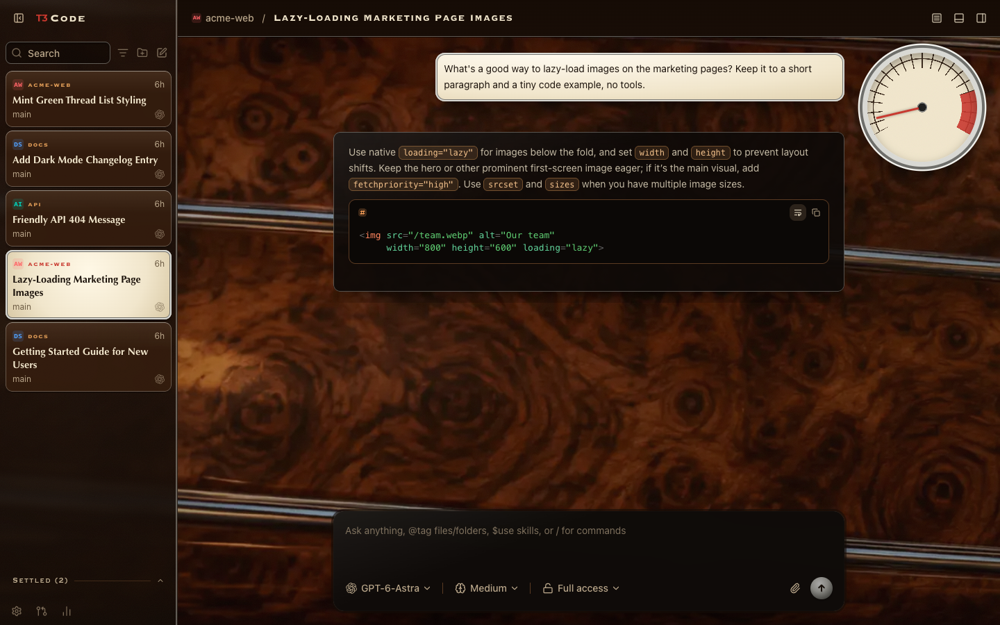

[`themes/walnut-dash.json`](themes/walnut-dash.json) · [sidebar](images/walnut-dash-sidebar.png)

#### Noir Office

A rain-streaked detective office in black and white: case-file threads, a client statement and an OPEN stamp. Light mode is a grey afternoon.*

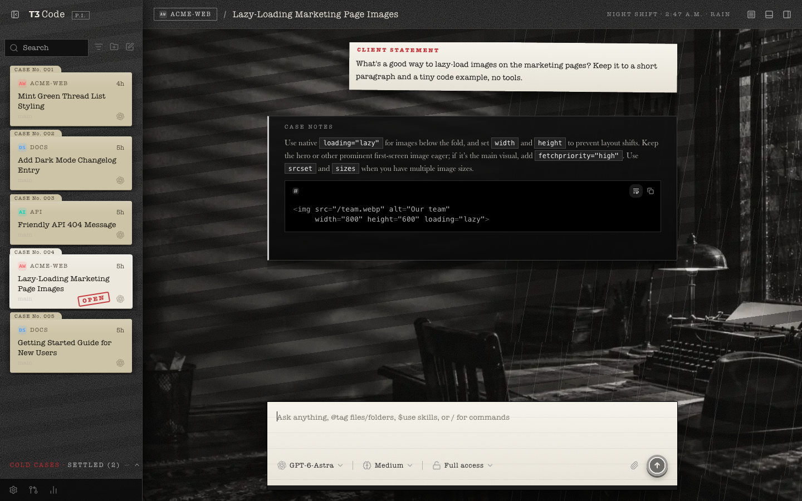

[`themes/noir-office.json`](themes/noir-office.json) · [sidebar](images/noir-office-sidebar.png) · [light](images/noir-office-light-full.png)

#### Dusty Saloon

An empty frontier saloon at golden hour: wanted-poster threads, a sheriff's star to send and a revolver cylinder that loads with the context.*

[`themes/dusty-saloon.json`](themes/dusty-saloon.json) · [sidebar](images/dusty-saloon-sidebar.png)

### Anime & games

#### Kumori Skies

An anime key visual: Kumori, an original cloud-hood sky spirit, sits on a summer cumulus next to the chat and waves from the sidebar. Carries its own art.*

[`themes/kumori-skies.json`](themes/kumori-skies.json) · [sidebar](images/kumori-skies-sidebar.png) · [dark](images/kumori-skies-dark-full.png)

#### Speedline

A black-and-white manga spread: inked panels for threads, a strip of manga frames and an original rooftop hero beside the chat. Carries its own art.*

[`themes/speedline.json`](themes/speedline.json) · [sidebar](images/speedline-sidebar.png) · [dark](images/speedline-dark-full.png)

#### Pocket Wilds

A painted anime battlefield with Lumoss, an original moss creature, party slots for threads and a battle text box for the composer. Carries its own art.*

[`themes/pocket-wilds.json`](themes/pocket-wilds.json) · [sidebar](images/pocket-wilds-sidebar.png) · [dark](images/pocket-wilds-dark-full.png)

#### Thunder Pocket

Sticker-chunky cards, lightning tiles and a round spark buddy with red cheeks.

[`themes/thunder-pocket.json`](themes/thunder-pocket.json) · [sidebar](images/thunder-pocket-sidebar.png) · [dark](images/thunder-pocket-dark-full.png)

#### Starlight Charm

An original magical girl drifting through a pastel dusk sky. Her wand sparkles while the agent works.*

[`themes/starlight-charm.json`](themes/starlight-charm.json) · [sidebar](images/starlight-charm-sidebar.png)

#### Cyber Ronin

A lone armoured swordsman over a neon city under a red moon, a blade that lengthens with the context and cherry petals that fall while the agent works.*

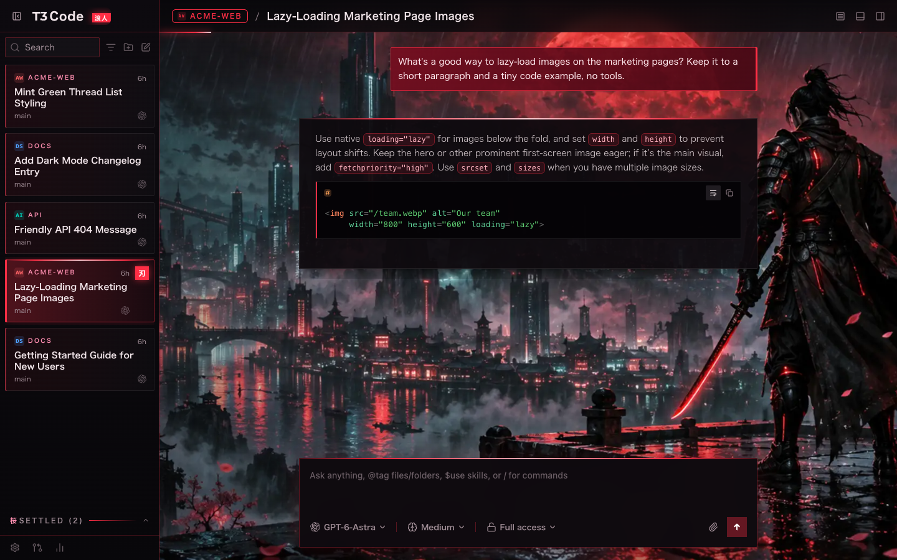

[`themes/cyber-ronin.json`](themes/cyber-ronin.json) · [sidebar](images/cyber-ronin-sidebar.png)

#### Mecha Cockpit

A pilot's-eye view from a giant robot over a sunset city: HUD brackets, a sync gauge for the context and an amber target lock.*

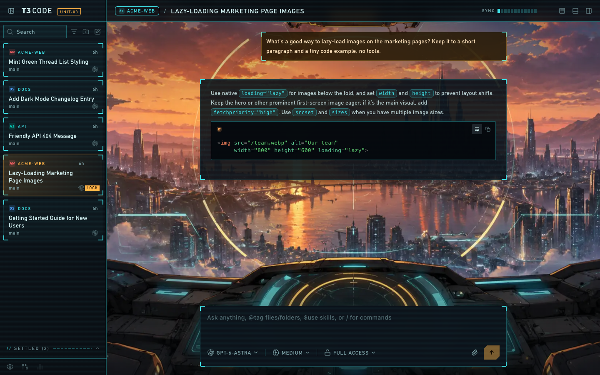

[`themes/mecha-cockpit.json`](themes/mecha-cockpit.json) · [sidebar](images/mecha-cockpit-sidebar.png)

#### Cube Frontier

A blocky sandbox world: inventory slots for threads, a pixel landscape, signboard messages and a hotbar composer with hearts.*

[`themes/cube-frontier.json`](themes/cube-frontier.json) · [sidebar](images/cube-frontier-sidebar.png) · [light](images/cube-frontier-light-full.png)

#### Brick Quest

A side-scrolling platformer level: a brick sidebar, star blocks for threads, warp pipes, coins and a score HUD. Original pixel art.*

[`themes/brick-quest.json`](themes/brick-quest.json) · [sidebar](images/brick-quest-sidebar.png) · [dark](images/brick-quest-dark-full.png)

#### Sunny Acres

A cozy 16-bit farm: a wooden fence sidebar, parchment dialog boxes and a stamina bar that drains with the context.*

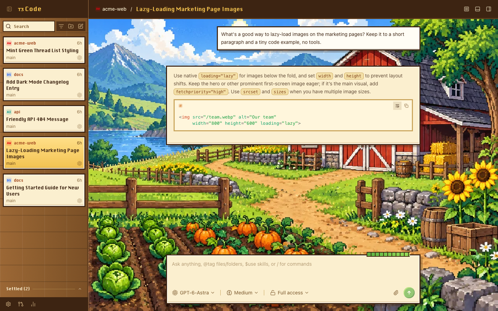

[`themes/sunny-acres.json`](themes/sunny-acres.json) · [sidebar](images/sunny-acres-sidebar.png)

#### Block Party

A toy-brick house on a studded baseplate: threads are colored bricks, and a row of studs over the composer lights up as the context fills.*

[`themes/block-party.json`](themes/block-party.json) · [sidebar](images/block-party-sidebar.png)

#### Ironhold

A stone keep: dark brick walls, a parchment scroll for the thread and gilded frames.

[`themes/ironhold.json`](themes/ironhold.json) · [sidebar](images/ironhold-sidebar.png) · [light](images/ironhold-light-full.png)

#### Jolly Roger

A treasure map on aged parchment, a wooden sidebar with rope trim and a wax seal on the open thread.

[`themes/jolly-roger.json`](themes/jolly-roger.json) · [sidebar](images/jolly-roger-sidebar.png) · [dark](images/jolly-roger-dark-full.png)

#### Pit Wall

Race control: a timing tower for threads, team-radio messages, a track map and a tyre panel. Light mode is daylight broadcast. [Live](images/pit-wall-live.gif).*

[`themes/pit-wall.json`](themes/pit-wall.json) · [sidebar](images/pit-wall-sidebar.png) · [light](images/pit-wall-light-full.png)

### Art classics

#### Starry Night

Van Gogh's The Starry Night (1889) behind deep-blue glass and a gold-framed composer. Light mode is the same village at first light.*

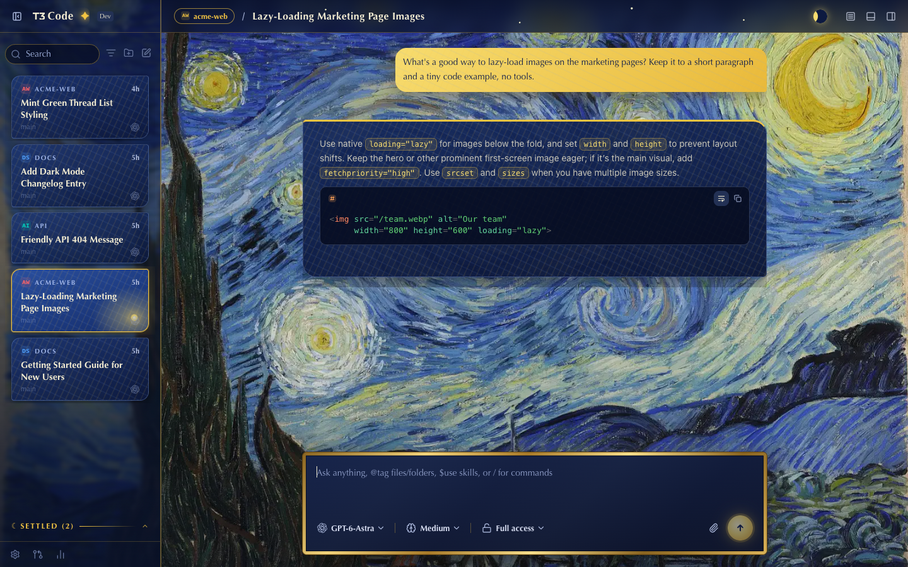

[`themes/starry-night.json`](themes/starry-night.json) · [sidebar](images/starry-night-sidebar.png) · [light](images/starry-night-light-full.png)

#### Ukiyo Wave

Hokusai's Great Wave behind washi cards, with Red Fuji in the sidebar. Dark mode is a night print in indigo.*

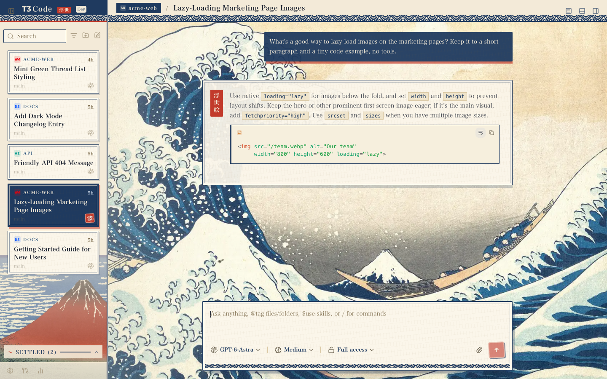

[`themes/ukiyo-wave.json`](themes/ukiyo-wave.json) · [sidebar](images/ukiyo-wave-sidebar.png) · [dark](images/ukiyo-wave-dark-full.png)

#### Edo Rain

Hiroshige's Sudden Shower over Shin-Ōhashi Bridge (1857) on washi paper with a red seal. The rain starts falling while the agent works.*

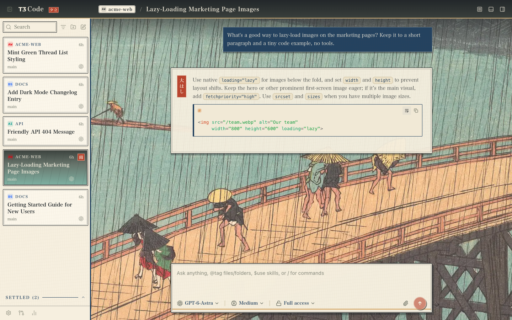

[`themes/edo-rain.json`](themes/edo-rain.json) · [sidebar](images/edo-rain-sidebar.png)

#### Water Lilies

Monet's Water Lilies (1906) behind misty glass, with lily-pad threads. Dark mode is the same pond under moonlight.*

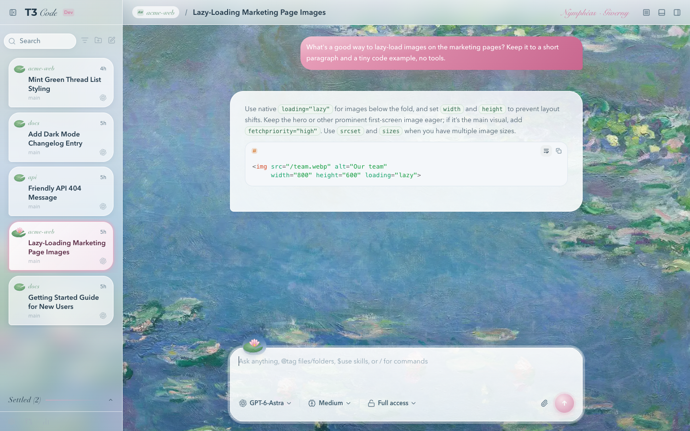

[`themes/water-lilies.json`](themes/water-lilies.json) · [sidebar](images/water-lilies-sidebar.png) · [dark](images/water-lilies-dark-full.png)

#### Grande Jatte

Seurat's A Sunday on La Grande Jatte with pointillist dot borders, a parasol to send and dots that shimmer while the agent works.*

[`themes/grande-jatte.json`](themes/grande-jatte.json) · [sidebar](images/grande-jatte-sidebar.png)

#### Gilded Gold

Klimt's The Kiss (1907–08) behind gold leaf on black lacquer, with mosaic bands. Light mode sets the gold on ivory.*

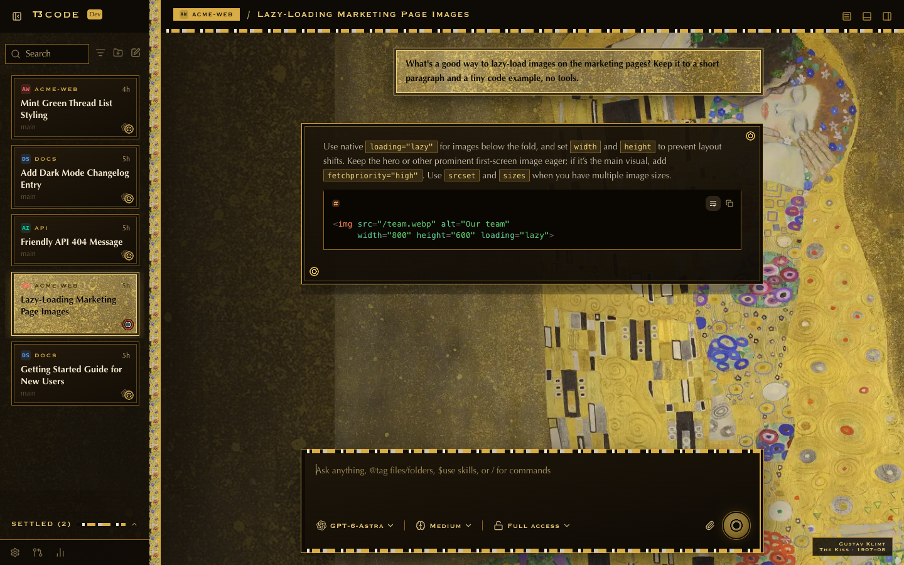

[`themes/gilded-gold.json`](themes/gilded-gold.json) · [sidebar](images/gilded-gold-sidebar.png) · [light](images/gilded-gold-light-full.png)

#### Mucha Seasons

Mucha's Spring and Autumn (1896) as arched panels beside the conversation, gilded rules and a nimbus that turns while the agent works.*

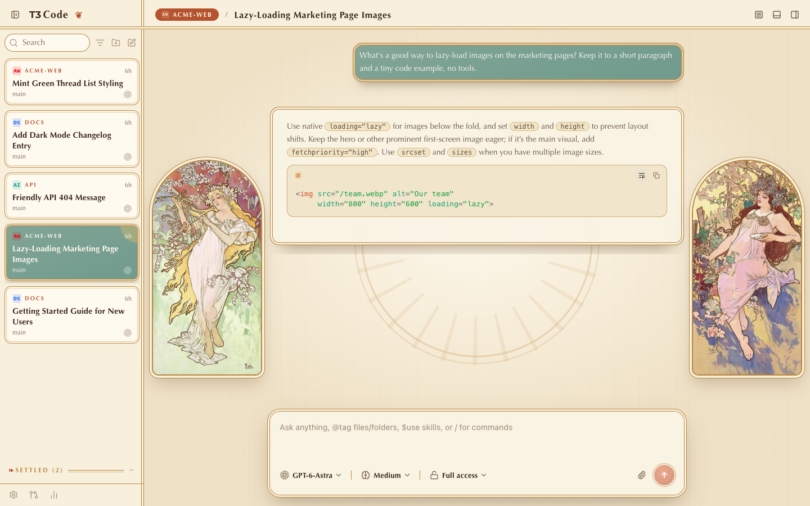

[`themes/mucha-seasons.json`](themes/mucha-seasons.json) · [sidebar](images/mucha-seasons-sidebar.png)

#### Delft

Vermeer's View of Delft by day and Girl with a Pearl Earring by night, with a pearl that glows while the agent works.*

[`themes/delft.json`](themes/delft.json) · [sidebar](images/delft-sidebar.png) · [dark](images/delft-dark-full.png)

#### Turner Seas

Turner's The Fighting Temeraire by day and Fishermen at Sea by moonlight, with a brass barometer that swings as the context fills.*

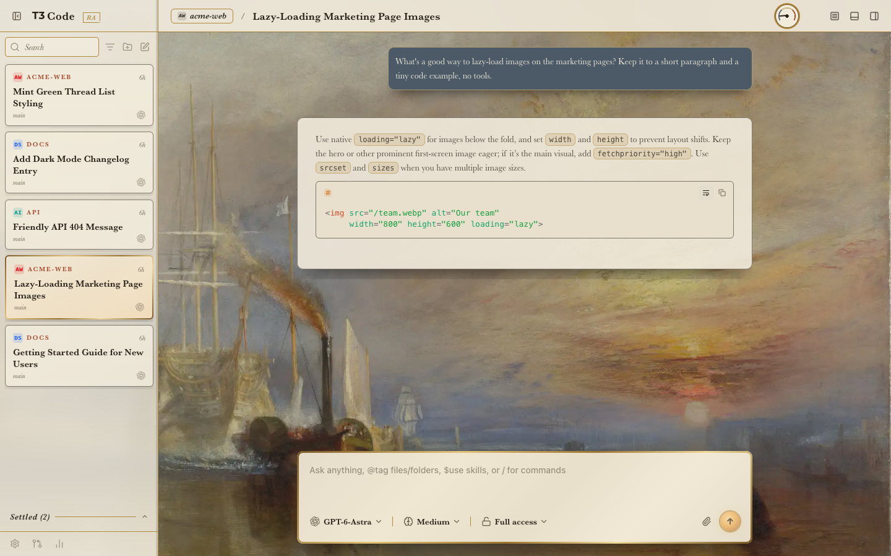

[`themes/turner-seas.json`](themes/turner-seas.json) · [sidebar](images/turner-seas-sidebar.png) · [dark](images/turner-seas-dark-full.png)

#### De Stijl

Piet Mondrian's Composition II in Red, Blue and Yellow (1930) in the sidebar, with black grid lines and primary planes around the conversation.*

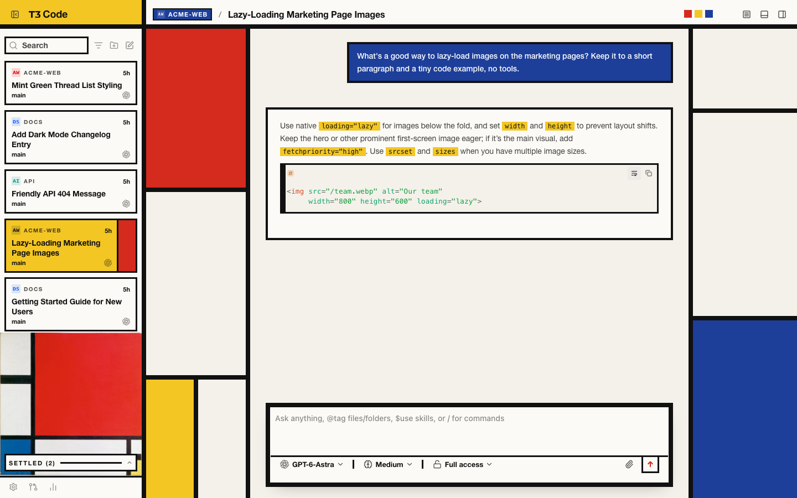

[`themes/de-stijl.json`](themes/de-stijl.json) · [sidebar](images/de-stijl-sidebar.png) · [dark](images/de-stijl-dark-full.png)

#### Komposition

Kandinsky's Composition VIII by day and Several Circles by night, with his triangle, square and circle orbiting while the agent works.*

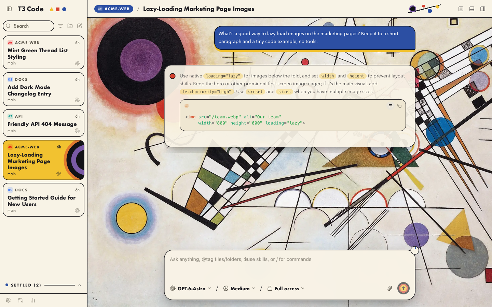

[`themes/komposition.json`](themes/komposition.json) · [sidebar](images/komposition-sidebar.png) · [dark](images/komposition-dark-full.png)

#### Nile Papyrus

The Book of the Dead of Hunefer (c. 1275 BCE) behind papyrus cards, with an Eye of Horus and an ankh. Dark mode reads the scroll by torchlight.*

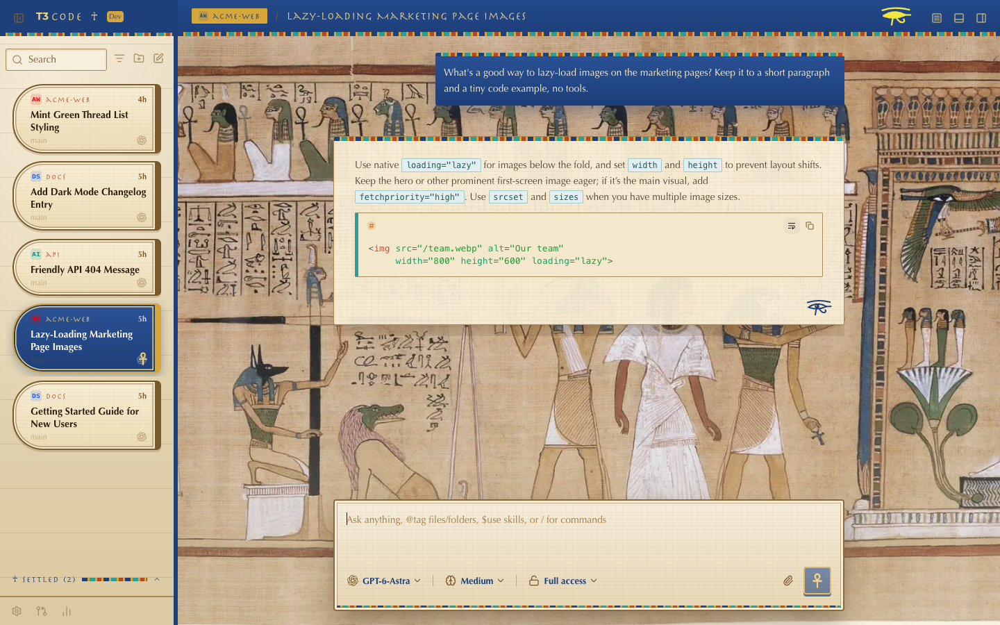

[`themes/nile-papyrus.json`](themes/nile-papyrus.json) · [sidebar](images/nile-papyrus-sidebar.png) · [dark](images/nile-papyrus-dark-full.png)

#### Fossil Field Notes

An expedition journal: specimen tags for threads and graph-paper pages over Charles R. Knight's 1897 *Leaping Laelaps* (public domain).*

[`themes/fossil-notes.json`](themes/fossil-notes.json) · [sidebar](images/fossil-notes-sidebar.png) · [dark](images/fossil-notes-dark-full.png)

### Nature & cozy

#### Meadow

Sunlit grass behind frosted, leafy glass. Carries its own photos.*

[`themes/meadow.json`](themes/meadow.json) · [sidebar](images/meadow-sidebar.png) · [dark](images/meadow-dark-full.png)

#### Jade Falls

A misty rainforest waterfall pouring into a jade pool, leaf-green glass cards and a vine over the composer that grows with the context.*

[`themes/jade-falls.json`](themes/jade-falls.json) · [sidebar](images/jade-falls-sidebar.png)

#### Watercolor Vale

A loose watercolor valley on cold-press paper. A wash blooms behind the composer while the agent works.*

[`themes/watercolor-vale.json`](themes/watercolor-vale.json) · [sidebar](images/watercolor-vale-sidebar.png)

#### Sakura Drift

A cherry branch over a misty lake and pagoda, with petals that drift down while the agent works.*

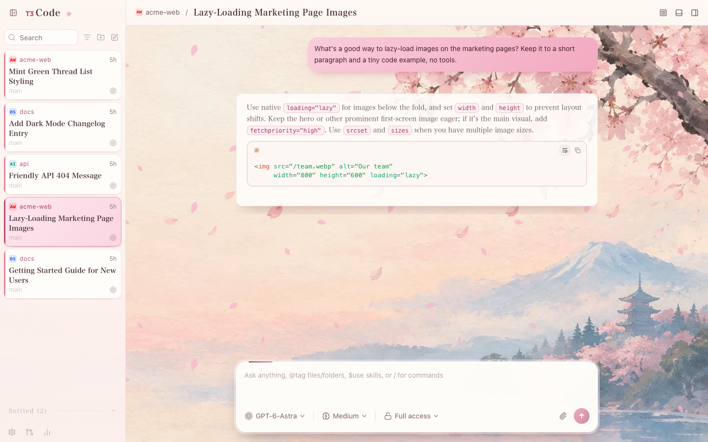

[`themes/sakura-drift.json`](themes/sakura-drift.json) · [sidebar](images/sakura-drift-sidebar.png)

#### Coral Glow

A glowing coral reef under shafts of sunlight, sea-glass panels and jellyfish that pulse while the agent works.*

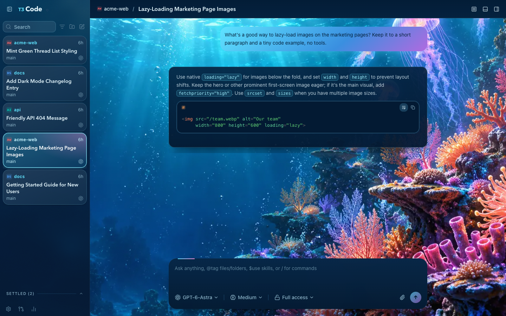

[`themes/coral-glow.json`](themes/coral-glow.json) · [sidebar](images/coral-glow-sidebar.png)

#### Ember Camp

A campfire under the Milky Way that flares while the agent works, dusk-blue glass and a spark line that grows with the context.*

[`themes/ember-camp.json`](themes/ember-camp.json) · [sidebar](images/ember-camp-sidebar.png)

#### Winter Cabin

A log cabin by the fire with Fair Isle knit trim and snow at the window. Light mode is a bright snowy morning.*

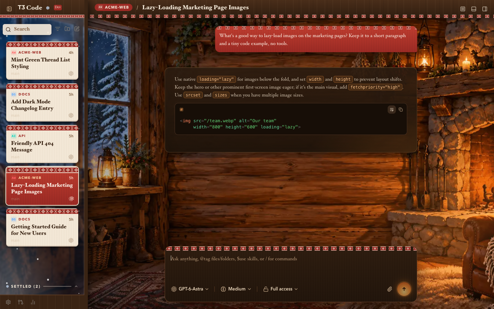

[`themes/winter-cabin.json`](themes/winter-cabin.json) · [sidebar](images/winter-cabin-sidebar.png) · [light](images/winter-cabin-light-full.png)

#### Lo-fi Cafe

A rainy window seat in a neon-lit cafe: a chalkboard menu for threads and an order ticket for the prompt. Light mode is a rainy afternoon.*

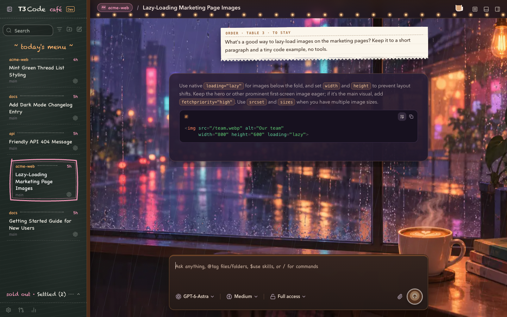

[`themes/lofi-cafe.json`](themes/lofi-cafe.json) · [sidebar](images/lofi-cafe-sidebar.png) · [light](images/lofi-cafe-light-full.png)

#### Pumpkin Night

A misty pumpkin patch under a full moon. The jack-o'-lanterns glow brighter while the agent works and a candle wick burns down with the context.*

[`themes/pumpkin-night.json`](themes/pumpkin-night.json) · [sidebar](images/pumpkin-night-sidebar.png)

#### Boba Bar

A brown sugar milk tea on a latte backdrop. Pearls rise while the agent works and a row of tapioca pearls fills with the context.*

[`themes/boba-bar.json`](themes/boba-bar.json) · [sidebar](images/boba-bar-sidebar.png) · [dark](images/boba-bar-dark-full.png)

#### Paper Crane

Folded paper cranes over handmade washi that bob while the agent works, and a coral crease that grows with the context.*

[`themes/paper-crane.json`](themes/paper-crane.json) · [sidebar](images/paper-crane-sidebar.png)

#### Pinboard

A cork board with sticky-note threads, pinned photos, a reply sheet and a red string that runs out as the context fills.*

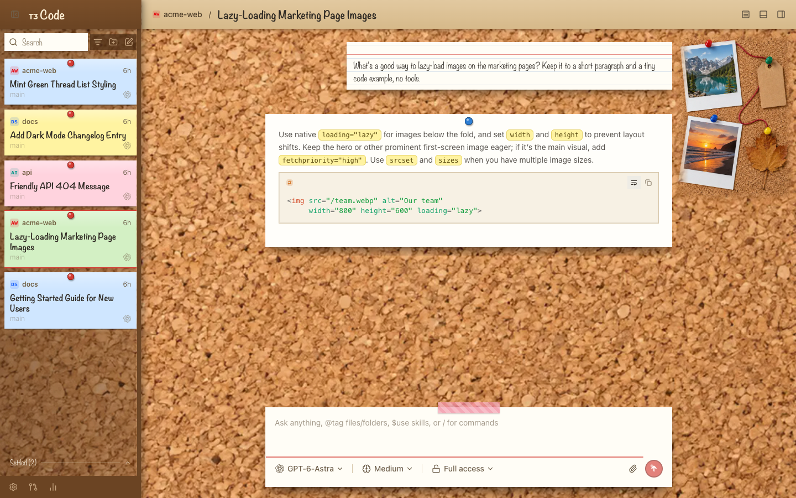

[`themes/pinboard.json`](themes/pinboard.json) · [sidebar](images/pinboard-sidebar.png)

#### Gumdrop Parlor

A candy shop: striped awning, wrapped-candy threads, frosting drips, sprinkles, a gumdrop jar and a peppermint composer.*

[`themes/gumdrop-parlor.json`](themes/gumdrop-parlor.json) · [sidebar](images/gumdrop-parlor-sidebar.png) · [dark](images/gumdrop-parlor-dark-full.png)

#### Mochi Hug

Plushie stitches and die-cut stickers with three original mochi friends: Mochi, Ichigo and Matcha.*

[`themes/mochi-hug.json`](themes/mochi-hug.json) · [sidebar](images/mochi-hug-sidebar.png) · [dark](images/mochi-hug-dark-full.png)

#### Pink Love

Big wrapping thread titles and each thread's project as a pill on its top edge. Light and dark.

[`themes/pink-love.json`](themes/pink-love.json) · [sidebar](images/pink-love-light-sidebar.png) · [dark](images/pink-love-dark-full.png) · [light](images/pink-love-light-full.png)

### Sci-fi

#### Orbital

Mission control glass over Earth, shot from the ISS. Carries its own photos.*

[`themes/orbital.json`](themes/orbital.json) · [sidebar](images/orbital-sidebar.png) · [light](images/orbital-light-full.png)

#### Digital Rain

Falling glyph columns behind a green phosphor terminal.

[`themes/digital-rain.json`](themes/digital-rain.json) · [sidebar](images/digital-rain-sidebar.png) · [light](images/digital-rain-light-full.png)

#### Neon Circuit

Yellow, cyan and magenta on near-black with circuit traces, chamfered cards and HUD corners.

[`themes/cyberpunk-neon-circuit.json`](themes/cyberpunk-neon-circuit.json) · [sidebar](images/cyberpunk-neon-circuit-sidebar.png) · [light](images/cyberpunk-neon-circuit-light-full.png)

#### Nebula Terminal

A 1970s starship window on a teal and magenta nebula: amber console panels, [ TX ] and [ RX ] tags and a fuel bar that drains with the context.*

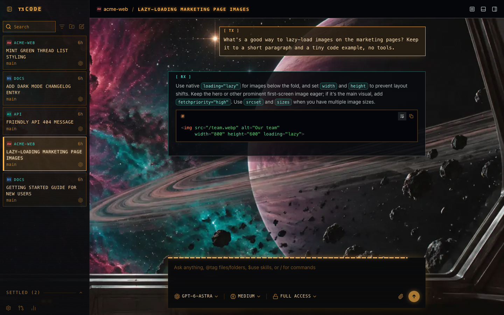

[`themes/nebula-terminal.json`](themes/nebula-terminal.json) · [sidebar](images/nebula-terminal-sidebar.png)

#### Abyssal Glow

A deep-sea trench of glowing jellyfish behind teal-rimmed glass, with a depth readout in the header. Light mode is sunlit reef shallows.*

[`themes/abyssal-glow.json`](themes/abyssal-glow.json) · [sidebar](images/abyssal-glow-sidebar.png) · [light](images/abyssal-glow-light-full.png)

#### Rain Alley

A rain-soaked neon alley with wet-glass panels and a cyan tube over the composer that fills with the context.*

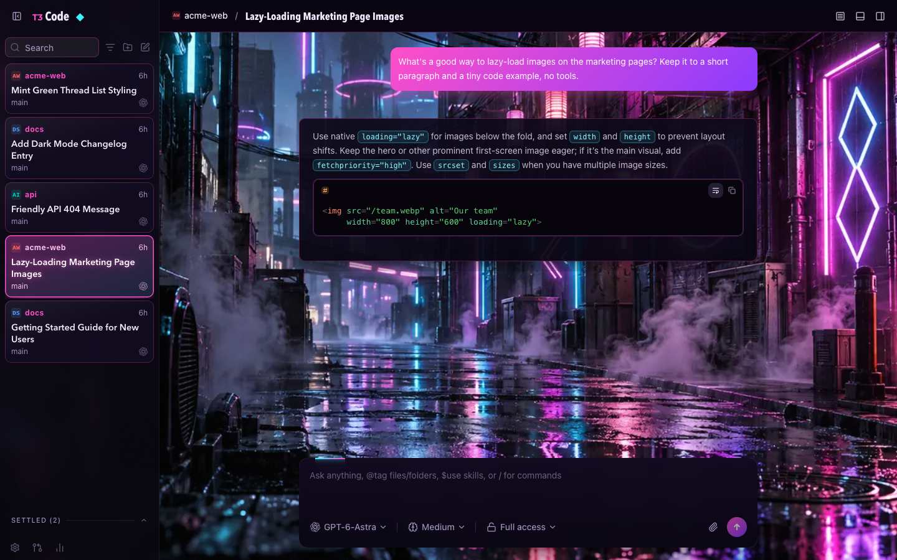

[`themes/rain-alley.json`](themes/rain-alley.json) · [sidebar](images/rain-alley-sidebar.png)

#### Brass Workshop

A steampunk workshop of gauges, pipes and an orrery behind riveted brass plates. Light mode opens the shutters.*

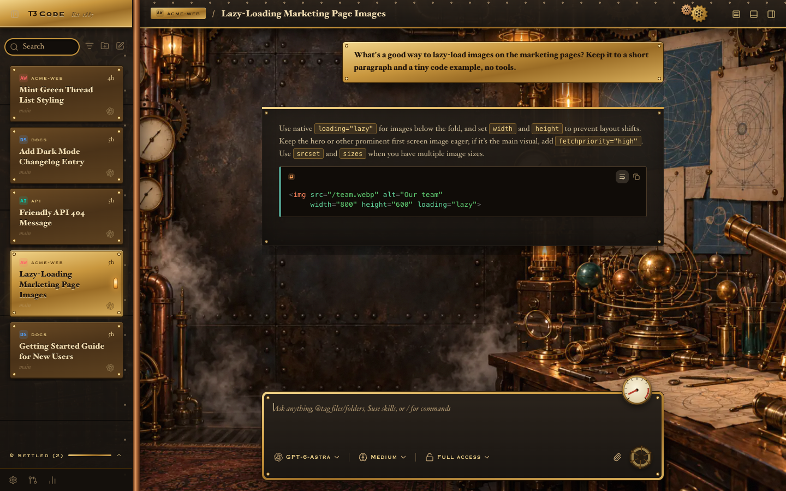

[`themes/brass-workshop.json`](themes/brass-workshop.json) · [sidebar](images/brass-workshop-sidebar.png) · [light](images/brass-workshop-light-full.png)

### Animated

#### Firefly Meadow

Fireflies drifting over a dusky meadow under a crescent moon. Light mode is a hazy summer afternoon. [Live](images/firefly-meadow-live.gif).*

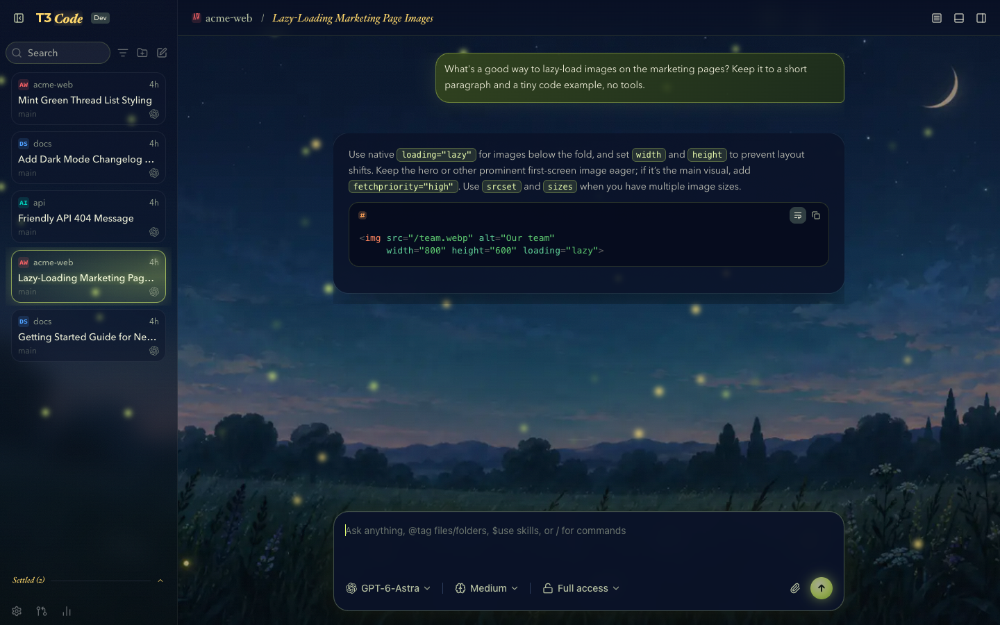

[`themes/firefly-meadow.json`](themes/firefly-meadow.json) · [sidebar](images/firefly-meadow-sidebar.png) · [light](images/firefly-meadow-light-full.png)

#### Dune Mirage

Sun-baked dunes and heat haze. Dark mode is the same desert under a cold moon. [Live](images/dune-mirage-live.gif).*

[`themes/dune-mirage.json`](themes/dune-mirage.json) · [sidebar](images/dune-mirage-sidebar.png) · [dark](images/dune-mirage-dark-full.png)

#### Northern Lights

Aurora curtains over mountains and a still lake. Light mode is an icy arctic dawn. [Live](images/northern-lights-live.gif).*

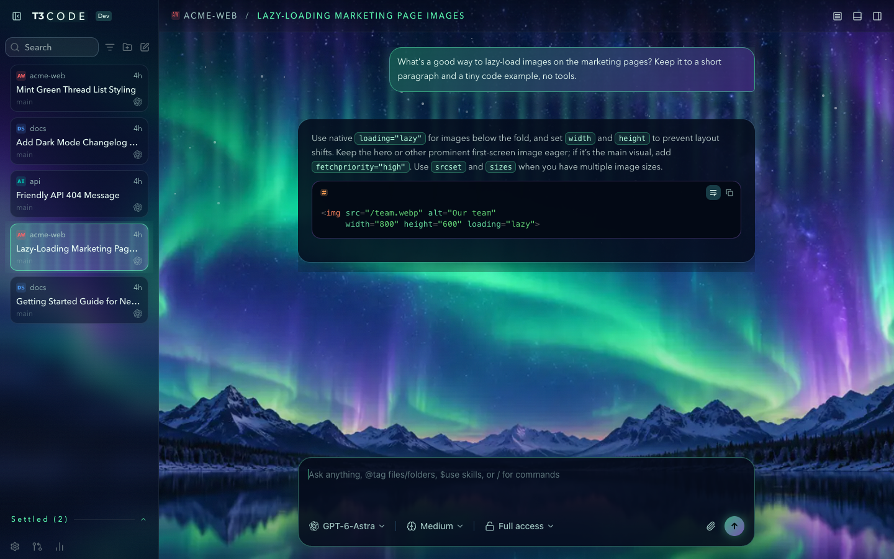

[`themes/northern-lights.json`](themes/northern-lights.json) · [sidebar](images/northern-lights-sidebar.png) · [light](images/northern-lights-light-full.png)

#### Chalk Talk

Chalk lettering and doodles on a green board. Light mode is a whiteboard with dry-erase markers. [Live](images/chalkboard-live.gif).*

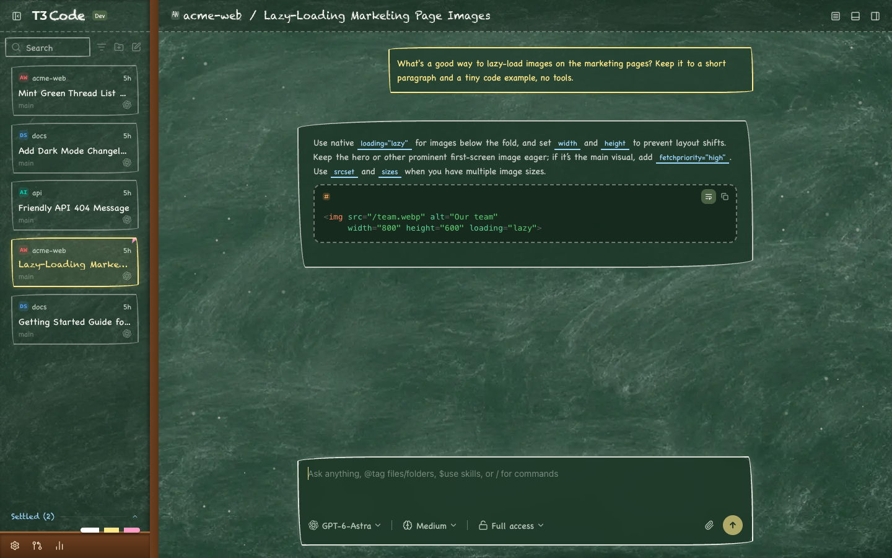

[`themes/chalkboard.json`](themes/chalkboard.json) · [sidebar](images/chalkboard-sidebar.png) · [light](images/chalkboard-light-full.png)

#### Blueprint

White lines on drafting blue: numbered sheet threads, a spec-sheet reply and a title-block composer. Light mode is a whiteprint. [Live](images/blueprint-live.gif).*

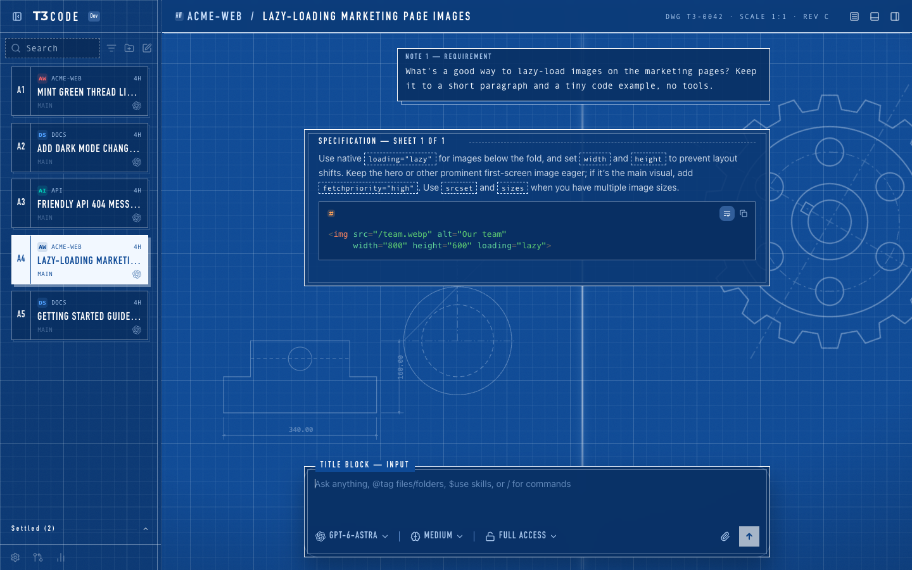

[`themes/blueprint.json`](themes/blueprint.json) · [sidebar](images/blueprint-sidebar.png) · [light](images/blueprint-light-full.png)

#### Rose Window

A candlelit cathedral under a stained-glass rose window. Light mode is the nave at noon. [Live](images/rose-window-live.gif).*

[`themes/rose-window.json`](themes/rose-window.json) · [sidebar](images/rose-window-sidebar.png) · [light](images/rose-window-light-full.png)

#### Lava Lamp

Glowing wax blobs rising in a purple lamp. Light mode is the same lamp on a sunny cream shelf. [Live](images/lava-lamp-live.gif).

[`themes/lava-lamp.json`](themes/lava-lamp.json) · [sidebar](images/lava-lamp-sidebar.png) · [light](images/lava-lamp-light-full.png)

#### Disco Fever

A night club with a lit dance floor and a spinning mirror ball. Light mode is a daytime roller disco in sherbet pastels. [Live](images/disco-fever-live.gif).

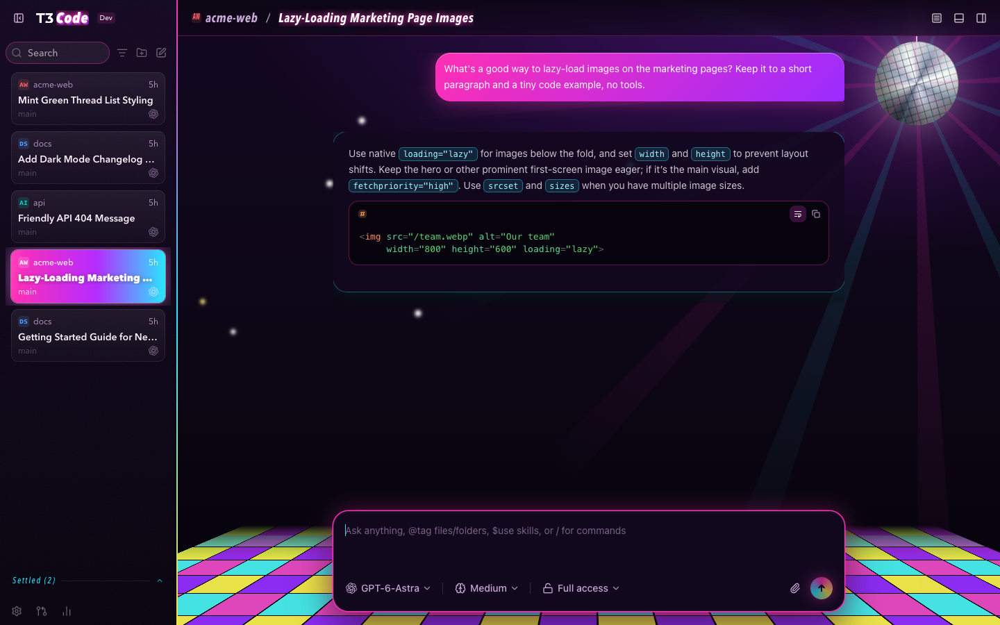

[`themes/disco-fever.json`](themes/disco-fever.json) · [sidebar](images/disco-fever-sidebar.png) · [light](images/disco-fever-light-full.png)

#### Holo Foil

Pastel holographic sticker foil with a moving rainbow sheen. Dark mode is black holo foil. [Live](images/holo-foil-live.gif).

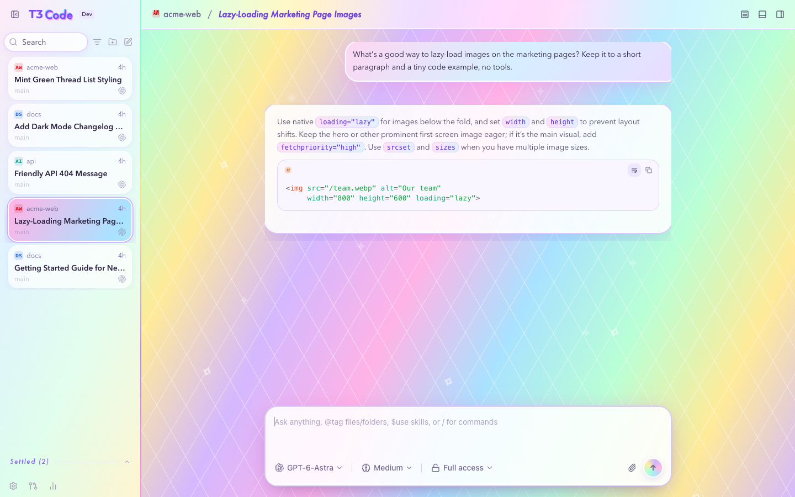

[`themes/holo-foil.json`](themes/holo-foil.json) · [sidebar](images/holo-foil-sidebar.png) · [dark](images/holo-foil-dark-full.png)

#### Pow! Pop Art

A comic splash page with a spinning sunburst, speech-balloon messages and a POW! burst. Dark mode is the midnight issue. [Live](images/pop-art-live.gif).

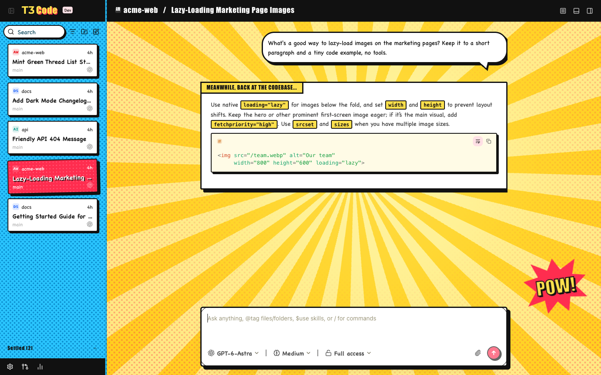

[`themes/pop-art.json`](themes/pop-art.json) · [sidebar](images/pop-art-sidebar.png) · [dark](images/pop-art-dark-full.png)

#### Pocket Pal

A candy-pink virtual pet on heart wallpaper. Dark mode is the same pet after lights-out. [Live](images/pocket-pal-live.gif).*

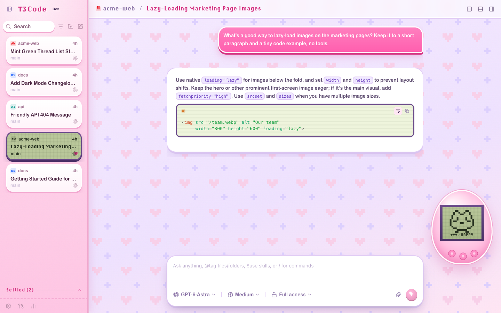

[`themes/pocket-pal.json`](themes/pocket-pal.json) · [sidebar](images/pocket-pal-sidebar.png) · [dark](images/pocket-pal-dark-full.png)

## An agent restyles the app from one prompt

"Make my T3 Code mint green with big, wrapping thread titles and each thread's project as a little
pill." The agent only uses the T3 Code theme tools: it reads the theme guide, writes a theme and sets
it, and the open app switches live.

| Before | After |
| --- | --- |
|  |  |

[Recording (mp4)](images/agent-restyles-live-app.mp4)

## The theme editor's CSS tab

The CSS targets `data-t3-part` hooks such as `thread-title` and `thread-project`; see
[`docs/user/custom-css.md`](https://github.com/TimPietrusky/t3code/blob/custom-css-theming/docs/user/custom-css.md)
on the branch for the full list. Screenshots use invented demo projects.
