# T3 Code custom CSS theme showcase

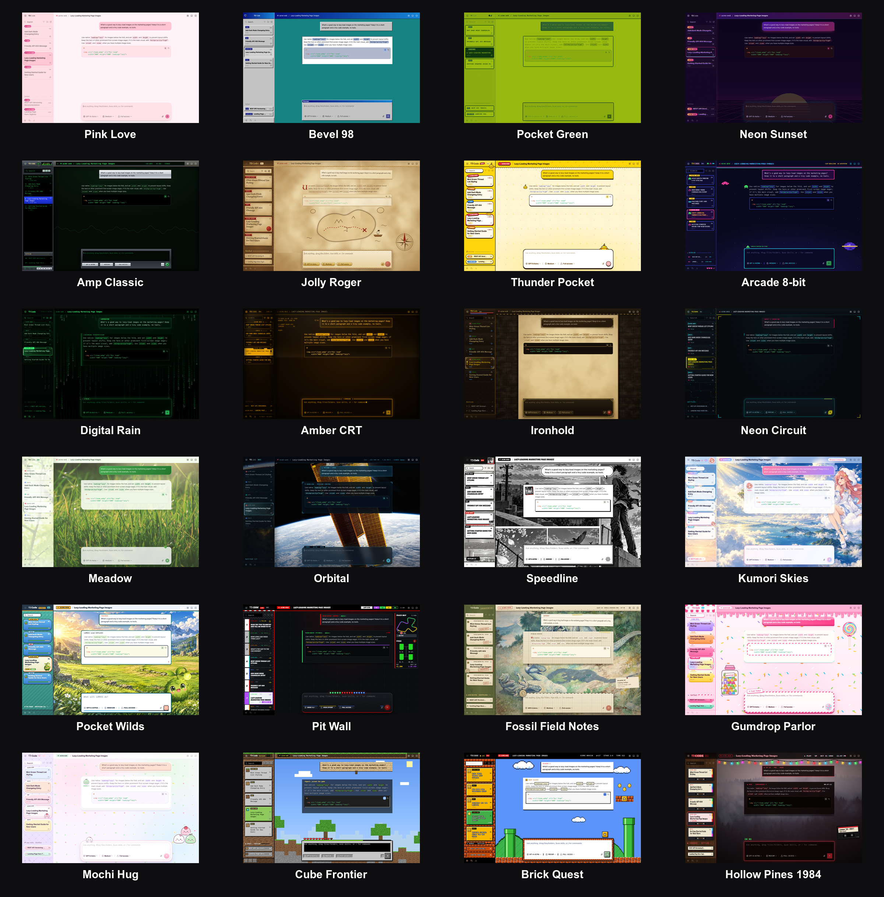

Example themes for a proposed T3 Code feature: themes that carry their own CSS, stable
`data-t3-part` hooks to target, and theme tools agents can call through the T3 Code MCP server.

- Proposal: [Ideas discussion on pingdotgg/t3code](https://github.com/pingdotgg/t3code/discussions/19088)
- Code: the [`custom-css-theming`](https://github.com/TimPietrusky/t3code/tree/custom-css-theming) branch

> Custom CSS isn't in a released T3 Code yet. In a current release, importing one of these themes
> applies its colors and ignores the CSS. Run the `custom-css-theming` branch to see them as shown.

## Use a theme

- **Import:** Settings → Appearance → **Add theme**, then choose the JSON file (or paste it).
- **Drop it in:** copy the file into `~/.t3/userdata/themes/` on the machine running T3 Code. The
  filename is the theme id; select it in Settings → Appearance or run `t3 theme set <id>`.
- **Ask your agent:** with the theme tools, hand it a file or describe the look you want in a thread
  with Full access.

\* Themes marked with * embed their own images (photos or original art), which needs the images-in-themes
support on the `custom-css-theming` branch. Credits: [`themes/ASSET-CREDITS.md`](themes/ASSET-CREDITS.md).

## Themes

### Pink Love

Big wrapping thread titles and each thread's project as a pill on its top edge. Light and dark.

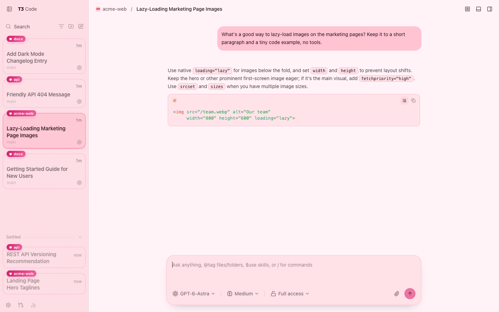

[`themes/pink-love.json`](themes/pink-love.json) · [sidebar](images/pink-love-light-sidebar.png) · [dark](images/pink-love-dark-full.png)

### Bevel 98

Grey 3D bevels, gradient title bars and a composer drawn as a dialog window.

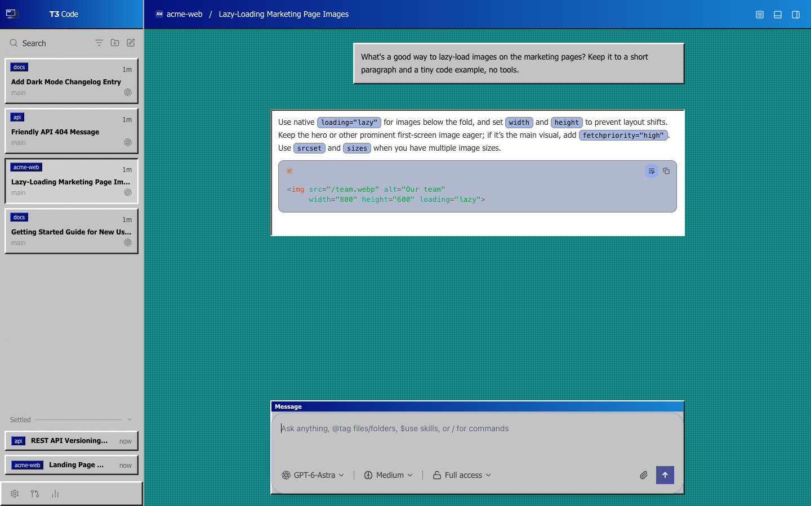

[`themes/bevel-98.json`](themes/bevel-98.json) · [sidebar](images/bevel-98-sidebar.png)

### Pocket Green

A four-shade handheld screen with pixel-stepped borders and a dot-matrix background.

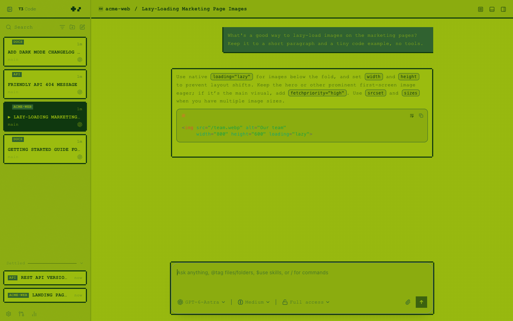

[`themes/pocket-green.json`](themes/pocket-green.json) · [sidebar](images/pocket-green-sidebar.png)

### Neon Sunset

A striped sun over a perspective grid, chrome titles and sunset pills.

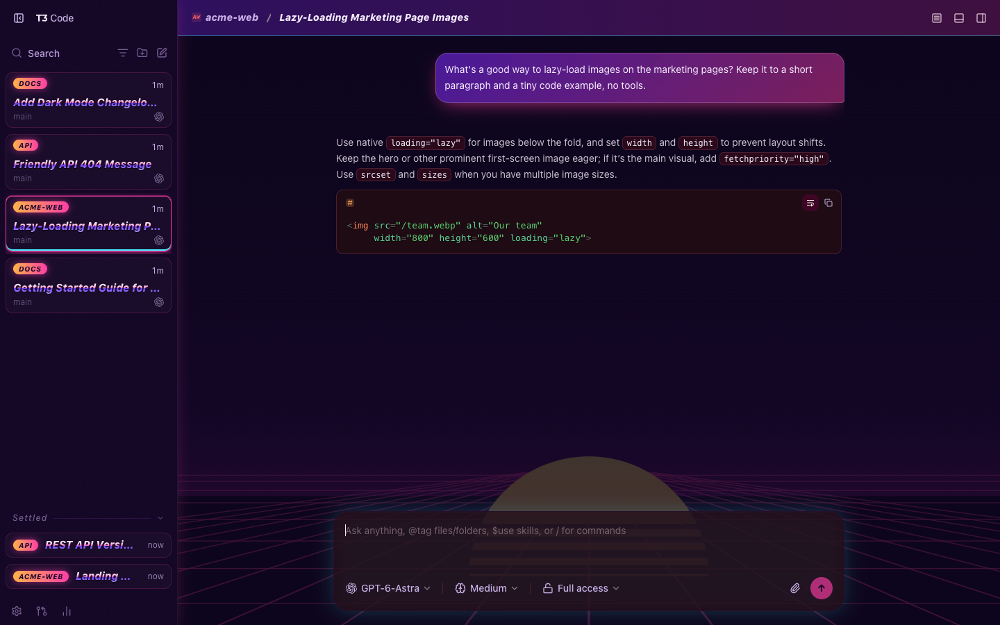

[`themes/neon-sunset.json`](themes/neon-sunset.json) · [sidebar](images/neon-sunset-sidebar.png)

### Amp Classic

A brushed-metal MP3 player skin: playlist sidebar, LCD title and a live spectrum. [Live](images/amp-classic-live.gif).

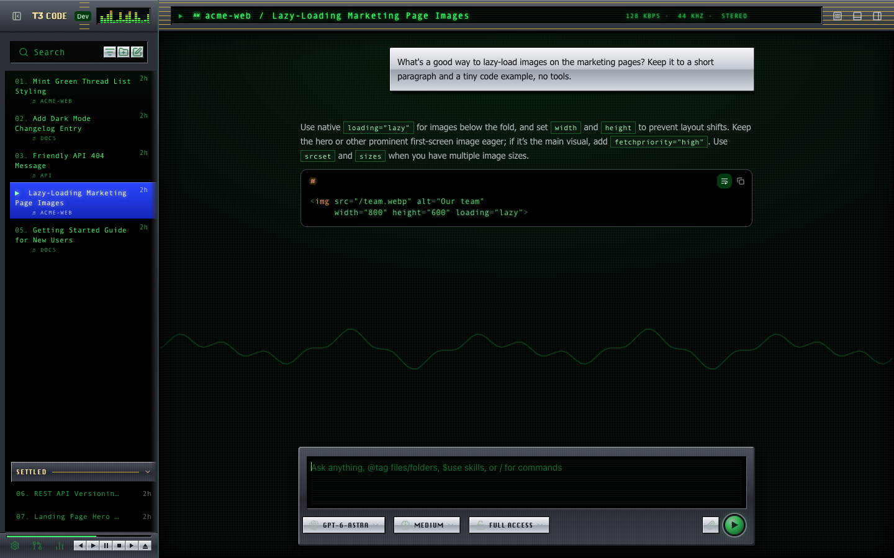

[`themes/amp-classic.json`](themes/amp-classic.json) · [sidebar](images/amp-classic-sidebar.png)

### Jolly Roger

A treasure map on aged parchment, a wooden sidebar with rope trim and a wax seal on the open thread.

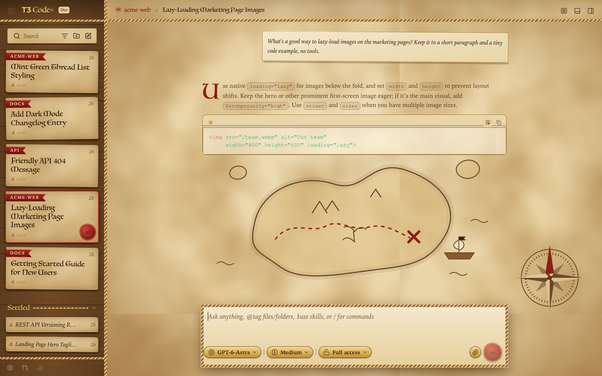

[`themes/jolly-roger.json`](themes/jolly-roger.json) · [sidebar](images/jolly-roger-sidebar.png)

### Thunder Pocket

Sticker-chunky cards, lightning tiles and a round spark buddy with red cheeks.

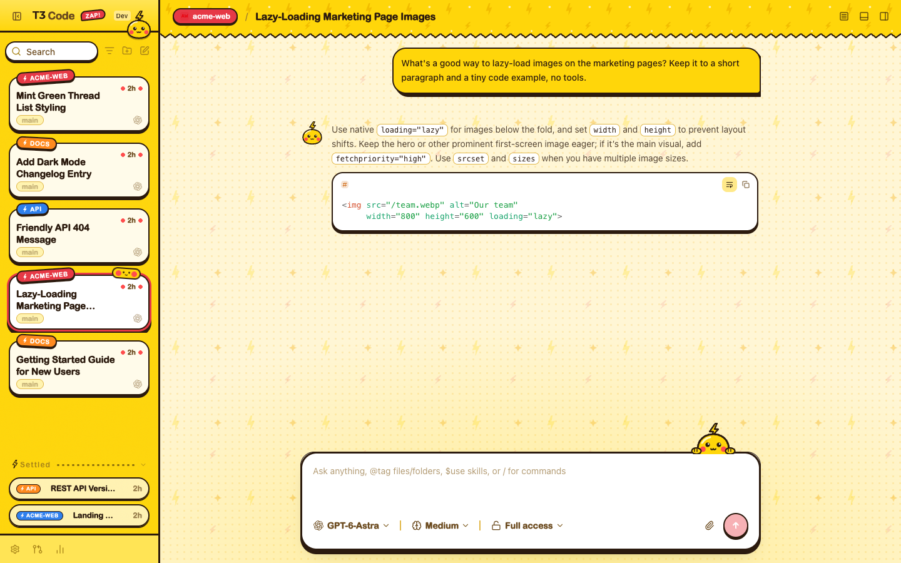

[`themes/thunder-pocket.json`](themes/thunder-pocket.json) · [sidebar](images/thunder-pocket-sidebar.png)

### Arcade 8-bit

A deep-space cabinet with notched pixel frames, invader sprites, coins and a score line.

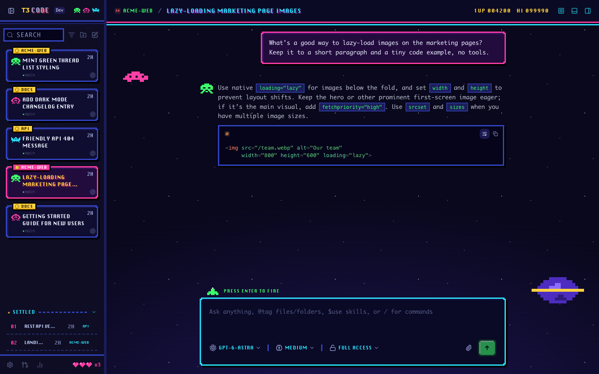

[`themes/arcade-8bit.json`](themes/arcade-8bit.json) · [sidebar](images/arcade-8bit-sidebar.png)

### Digital Rain

Falling glyph columns behind a green phosphor terminal.

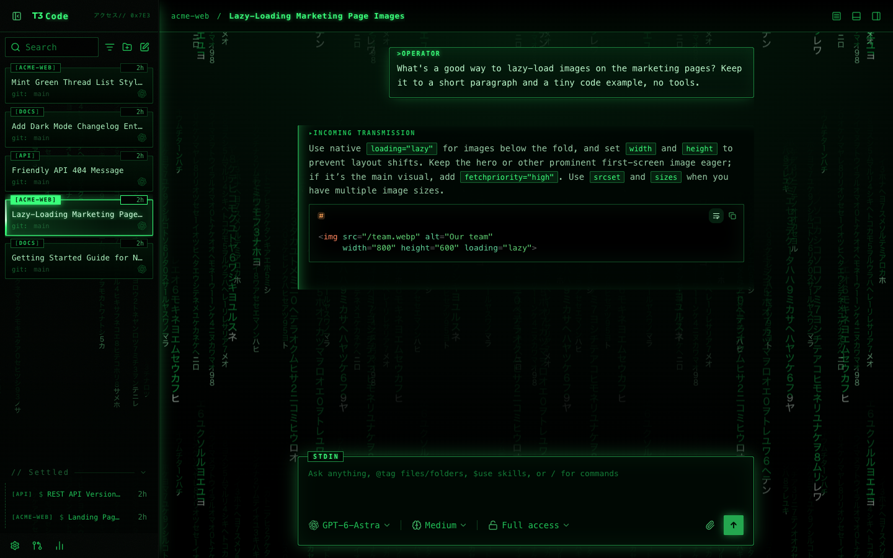

[`themes/digital-rain.json`](themes/digital-rain.json) · [sidebar](images/digital-rain-sidebar.png)

### Amber CRT

A curved amber phosphor tube with scanlines, glow and a blinking cursor.

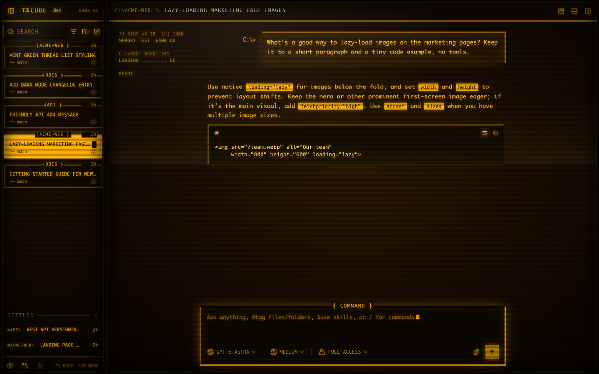

[`themes/amber-crt.json`](themes/amber-crt.json) · [sidebar](images/amber-crt-sidebar.png)

### Ironhold

A stone keep: dark brick walls, a parchment scroll for the thread and gilded frames.

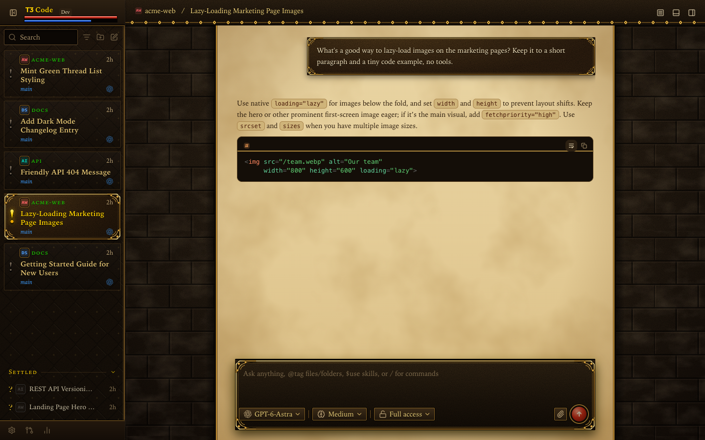

[`themes/ironhold.json`](themes/ironhold.json) · [sidebar](images/ironhold-sidebar.png)

### Neon Circuit

Yellow, cyan and magenta on near-black with circuit traces, chamfered cards and HUD corners.

[`themes/cyberpunk-neon-circuit.json`](themes/cyberpunk-neon-circuit.json) · [sidebar](images/cyberpunk-neon-circuit-sidebar.png)

### Meadow

Sunlit grass behind frosted, leafy glass. Carries its own photos.*

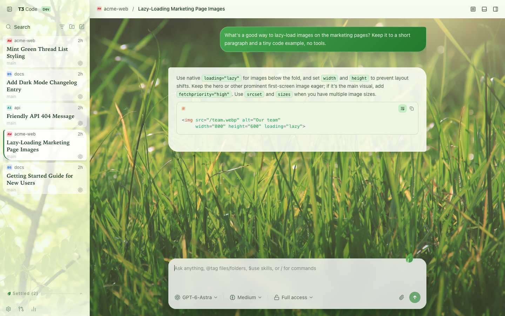

[`themes/meadow.json`](themes/meadow.json) · [sidebar](images/meadow-sidebar.png)

### Orbital

Mission control glass over Earth, shot from the ISS. Carries its own photos.*

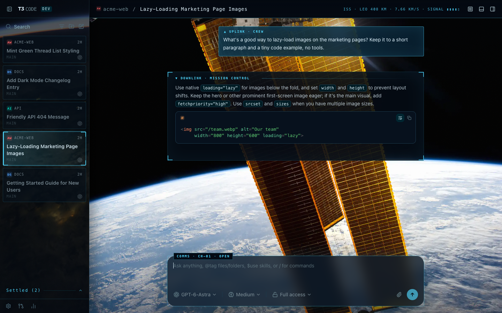

[`themes/orbital.json`](themes/orbital.json) · [sidebar](images/orbital-sidebar.png)

### Speedline

A black-and-white manga spread: inked panels for threads, a strip of manga frames and an original rooftop hero beside the chat. Carries its own art.*

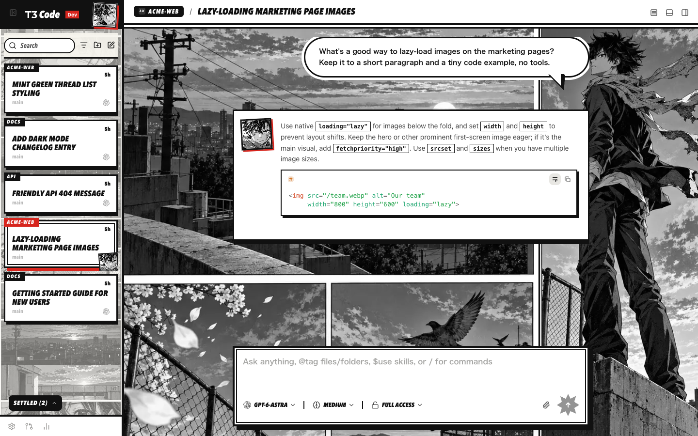

[`themes/speedline.json`](themes/speedline.json) · [sidebar](images/speedline-sidebar.png) · [dark](images/speedline-dark-full.png)

### Kumori Skies

An anime key visual: Kumori, an original cloud-hood sky spirit, sits on a summer cumulus next to the chat and waves from the sidebar. Carries its own art.*

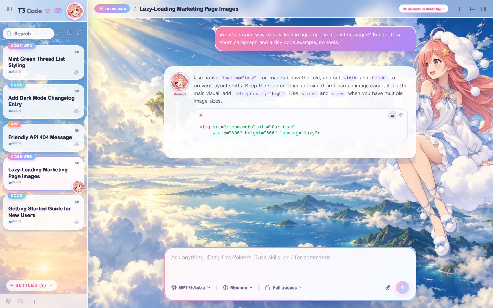

[`themes/kumori-skies.json`](themes/kumori-skies.json) · [sidebar](images/kumori-skies-sidebar.png) · [dark](images/kumori-skies-dark-full.png)

### Pocket Wilds

A painted anime battlefield with Lumoss, an original moss creature, party slots for threads and a battle text box for the composer. Carries its own art.*

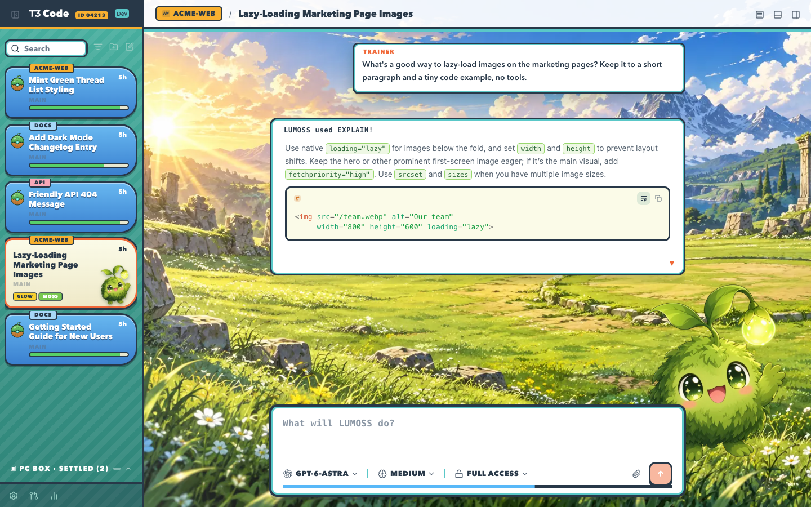

[`themes/pocket-wilds.json`](themes/pocket-wilds.json) · [sidebar](images/pocket-wilds-sidebar.png) · [dark](images/pocket-wilds-dark-full.png)

### Pit Wall

Race control: a timing tower for threads, team-radio messages, a track map and a tyre panel. Light mode is daylight broadcast.*

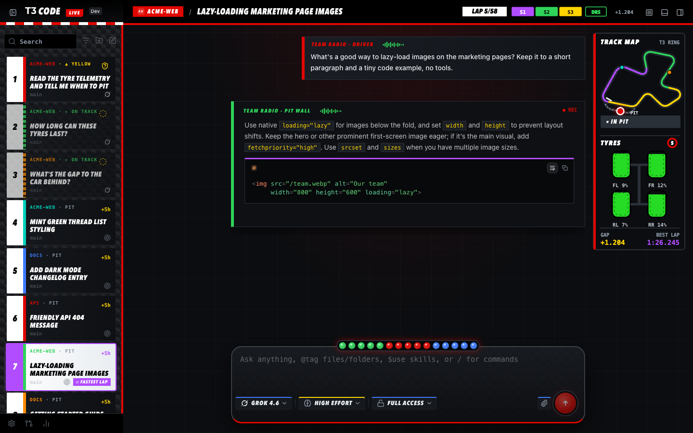

[`themes/pit-wall.json`](themes/pit-wall.json) · [sidebar](images/pit-wall-sidebar.png) · [light](images/pit-wall-light-full.png)

### Fossil Field Notes

An expedition journal: specimen tags for threads and graph-paper pages over Charles R. Knight's 1897 *Leaping Laelaps* (public domain).*

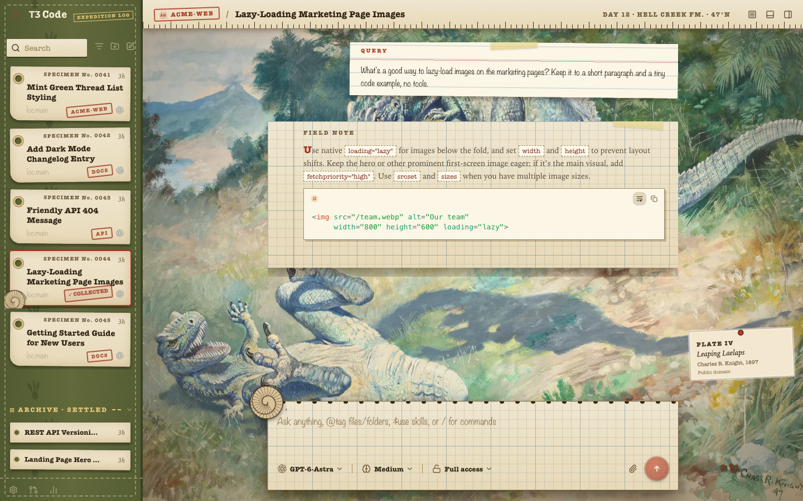

[`themes/fossil-notes.json`](themes/fossil-notes.json) · [sidebar](images/fossil-notes-sidebar.png) · [dark](images/fossil-notes-dark-full.png)

### Gumdrop Parlor

A candy shop: striped awning, wrapped-candy threads, frosting drips, sprinkles, a gumdrop jar and a peppermint composer.*

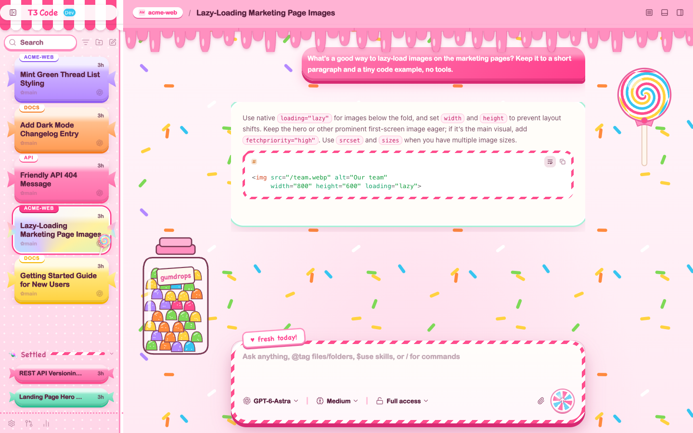

[`themes/gumdrop-parlor.json`](themes/gumdrop-parlor.json) · [sidebar](images/gumdrop-parlor-sidebar.png) · [dark](images/gumdrop-parlor-dark-full.png)

### Mochi Hug

Plushie stitches and die-cut stickers with three original mochi friends: Mochi, Ichigo and Matcha.*

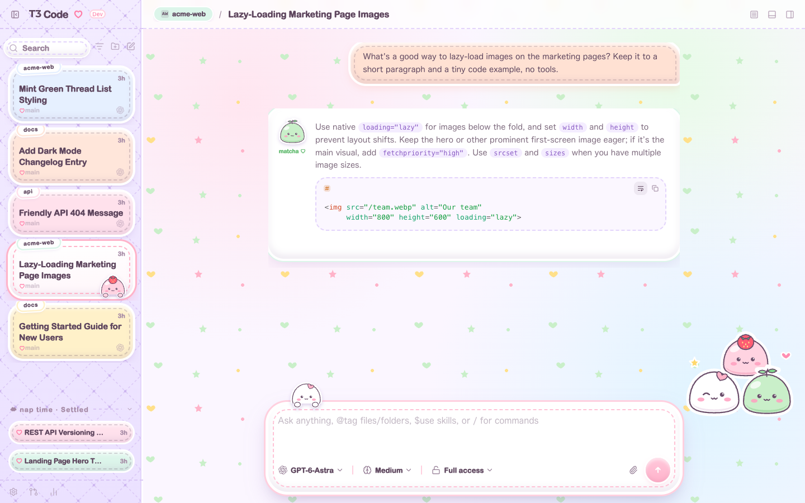

[`themes/mochi-hug.json`](themes/mochi-hug.json) · [sidebar](images/mochi-hug-sidebar.png) · [dark](images/mochi-hug-dark-full.png)

### Cube Frontier

A blocky sandbox world: inventory slots for threads, a pixel landscape, signboard messages and a hotbar composer with hearts.*

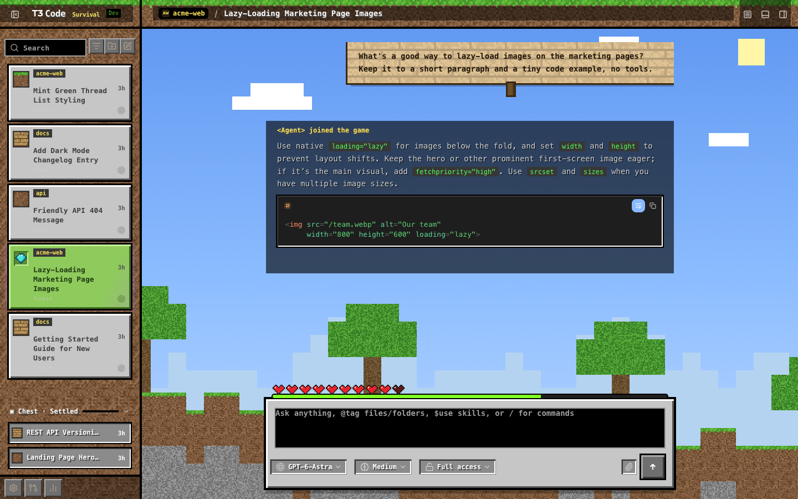

[`themes/cube-frontier.json`](themes/cube-frontier.json) · [sidebar](images/cube-frontier-sidebar.png) · [light](images/cube-frontier-light-full.png)

### Brick Quest

A side-scrolling platformer level: a brick sidebar, star blocks for threads, warp pipes, coins and a score HUD. Original pixel art.*

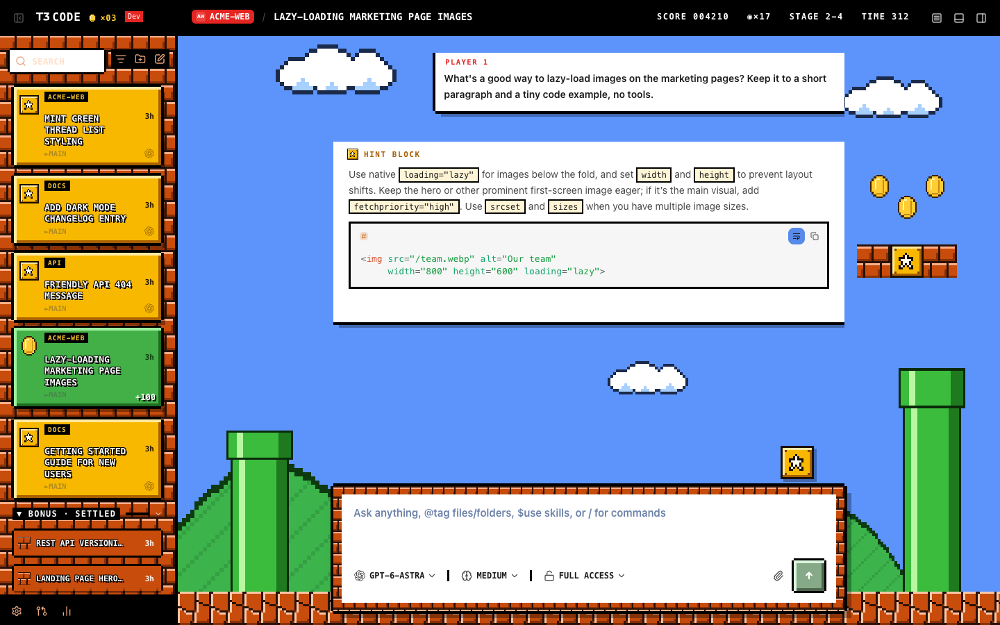

[`themes/brick-quest.json`](themes/brick-quest.json) · [sidebar](images/brick-quest-sidebar.png) · [dark](images/brick-quest-dark-full.png)

### Hollow Pines 1984

A small town after dark: cassette tapes for threads, a foggy pine forest, string lights and a VHS on-screen display.*

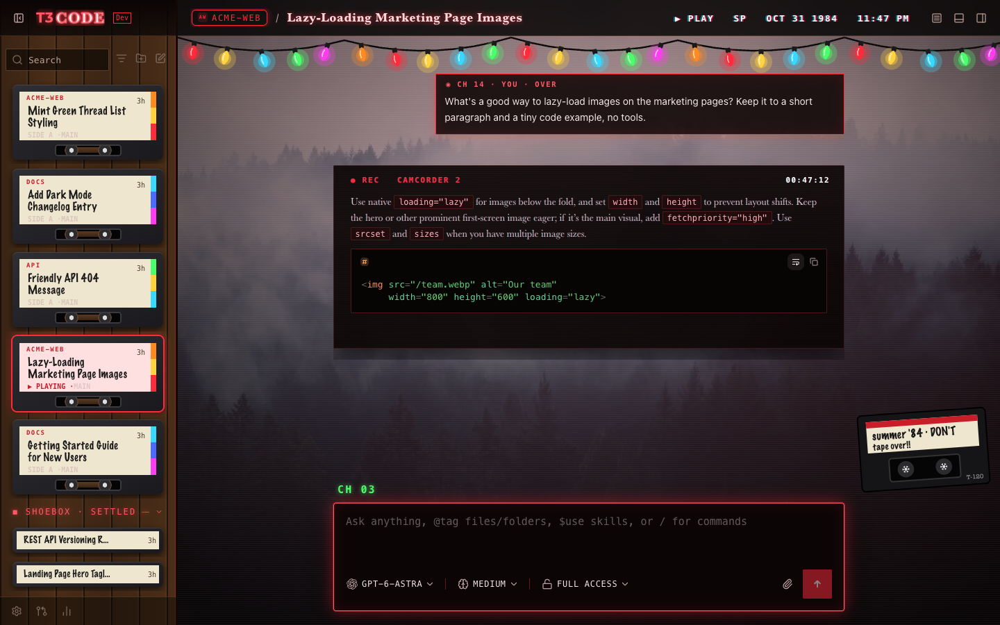

[`themes/hollow-pines.json`](themes/hollow-pines.json) · [sidebar](images/hollow-pines-sidebar.png) · [light](images/hollow-pines-light-full.png)

## An agent restyles the app from one prompt

"Make my T3 Code mint green with big, wrapping thread titles and each thread's project as a little
pill." The agent only uses the T3 Code theme tools: it reads the theme guide, writes a theme and sets
it, and the open app switches live.

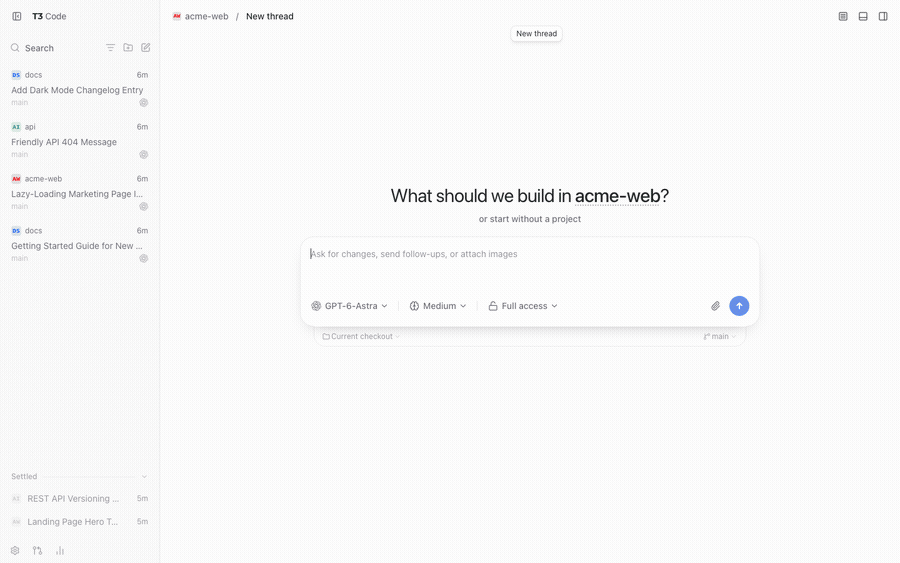

| Before | After |
| --- | --- |
| 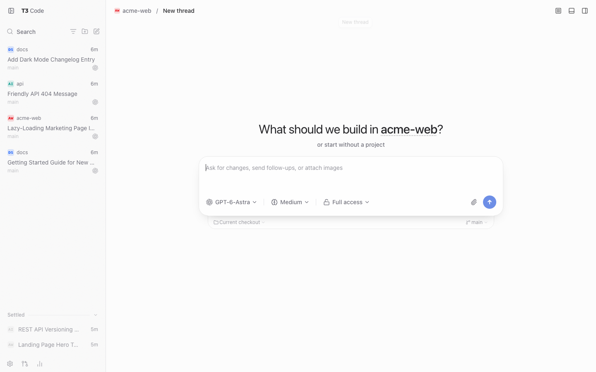 | 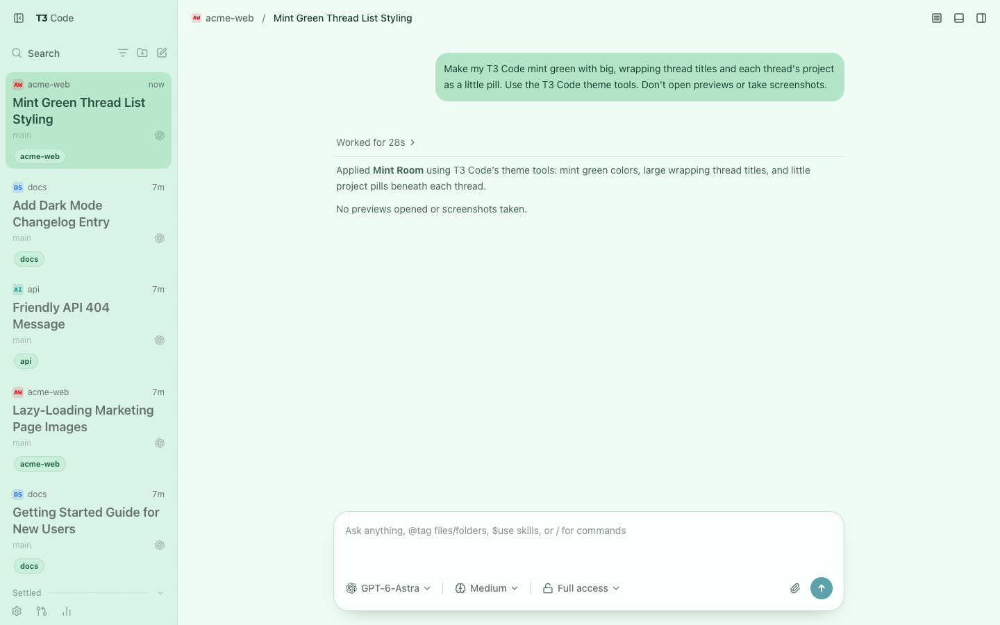 |

[Recording (mp4)](images/agent-restyles-live-app.mp4)

## The theme editor's CSS tab

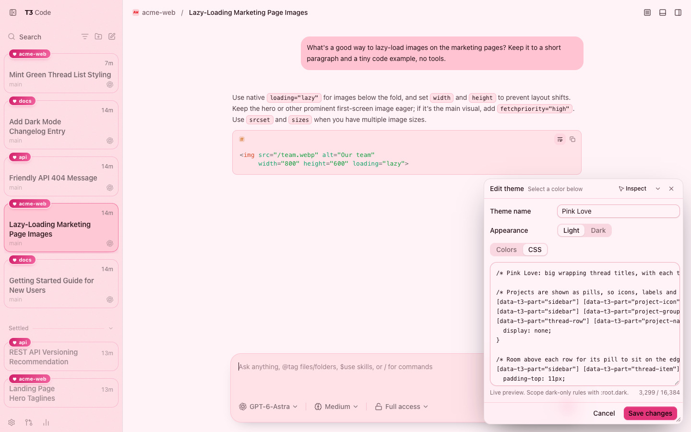

The CSS targets `data-t3-part` hooks such as `thread-title` and `thread-project`; see
[`docs/user/custom-css.md`](https://github.com/TimPietrusky/t3code/blob/custom-css-theming/docs/user/custom-css.md)
on the branch for the full list. Screenshots use invented demo projects.
